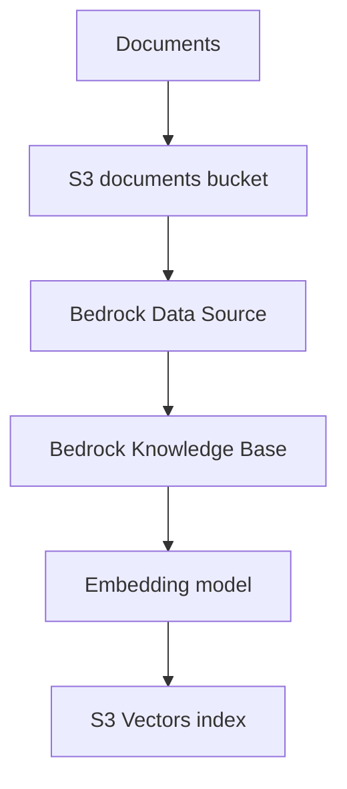

# terraform-aws-bedrock-vector-kb

[](https://github.com/IngMatrix-PGB/terraform-aws-bedrock-vector-kb/actions/workflows/terraform-ci.yml)
[](https://github.com/IngMatrix-PGB/terraform-aws-bedrock-vector-kb/releases)
[](LICENSE)

Terraform module for Amazon Bedrock Knowledge Bases backed by Amazon S3
Vectors: the vector store, a hardened documents bucket, and a least-privilege
execution role, for one or many Knowledge Bases from a single map input.

## Architecture



## Why this module

The official [`aws-ia/terraform-aws-bedrock`](https://github.com/aws-ia/terraform-aws-bedrock)
module also supports Knowledge Bases on S3 Vectors. It covers all of Bedrock
(agents, guardrails, prompts, several vector stores) behind one large
interface. This module does one thing - RAG infrastructure on S3 Vectors -
and owns the whole path:

| | aws-ia/terraform-aws-bedrock (v0.0.33) | This module |
|---|---|---|
| Scope | All of Bedrock, ~270 inputs | Knowledge Bases on S3 Vectors only |
| Knowledge Bases per module call | One | Many, through the `kbs` map |
| S3 Vectors bucket + index | Bring your own | Created by the module, or bring your own |
| Documents bucket | Bring your own | Created and hardened (TLS-only, ACLs off, versioning, optional KMS, lifecycle) |
| Embedding model / dimension check | No | Validated at `plan` time |
| Trust policy | Bedrock service principal | Plus `aws:SourceAccount` / `aws:SourceArn` (confused-deputy protection) |
| Tests | - | 118 `terraform test` cases, no AWS credentials needed |
| API stability | 0.x | 1.x (semver) |

Use `aws-ia/terraform-aws-bedrock` instead when you need Bedrock Agents,
Guardrails, or a vector store other than S3 Vectors (OpenSearch Serverless,
Aurora, Pinecone).

## Features

- Several Knowledge Bases from one `kbs` map
- S3 Vectors bucket + index created by the module, or an existing index ARN
- A documents bucket per Knowledge Base, with an optional prefix
- Chunking: fixed-size, hierarchical, semantic or none, validated against
  AWS's documented limits
- Embedding model / vector dimension validation for AWS-documented models
  (unknown models pass; explicit opt-out for stale entries)
- Optional SSE-KMS for the documents bucket and, separately, for S3 Vectors
- Optional ingestion log delivery (`APPLICATION_LOGS`) to a destination you
  already own
- Optional least-privilege IAM policy document for whoever runs
  `StartIngestionJob` (generated, never attached)
- Status and ID outputs for Knowledge Bases and data sources
- Opt-in `force_destroy` for demos and ephemeral environments

## Security

- **Documents bucket:** Block Public Access, ACLs disabled
  (`BucketOwnerEnforced`), TLS-only bucket policy, versioning, SSE-S3 by
  default or SSE-KMS with your key, incomplete multipart uploads aborted
  after 7 days, optional access logging and noncurrent-version expiration.
- **Execution role trust policy:** `bedrock.amazonaws.com` can assume it
  only with `aws:SourceAccount` = this account and `aws:SourceArn` matching
  a Knowledge Base in this account and region.
- **Execution role permissions:** each policy is scoped to one resource -
  the embedding model ARN, the documents bucket/prefix (pinned to this
  account with `aws:ResourceAccount`), the S3 Vectors index, and the KMS
  keys when set. No wildcard actions.
- **Partitions:** ARNs are built from `data.aws_partition`, so the module
  works in `aws`, `aws-us-gov` and `aws-cn`.
- **Not included, by design:** cross-region replication and S3 event
  notifications (Bedrock ingestion is started by API, not by S3 events).

## Usage

Examples:

- [`examples/basic`](examples/basic/main.tf) - one Knowledge Base, minimal inputs.
- [`examples/rag-e2e`](examples/rag-e2e) - a working RAG service: sample
  documents, ingestion script, and a Lambda behind an IAM-authenticated
  function URL that answers questions with `RetrieveAndGenerate` and cites
  its sources.

```hcl
module "bedrock_kb" {
  source = "git::https://github.com/IngMatrix-PGB/terraform-aws-bedrock-vector-kb.git?ref=v1.1.0"

  kbs = {
    default = {
      kb_name             = "my-knowledge-base"
      role_name           = "my-knowledge-base-role"
      embedding_model_arn = "arn:aws:bedrock:us-east-1::foundation-model/amazon.titan-embed-text-v2:0"

      content_bucket = "my-org-kb-documents"
      content_prefix = "docs/"

      create_s3vectors      = true
      s3vectors_bucket_name = "my-org-kb-vector-store"
      s3vectors_index_name  = "my-org-kb-vector-index"
      s3vectors_dimension   = 1024

      # Optional
      kms_key_arn = "arn:aws:kms:us-east-1:123456789012:key/your-key-id"
      chunking = {
        strategy   = "FIXED_SIZE"
        fixed_size = { max_tokens = 512, overlap_percentage = 20 }
      }
    }
  }
}
```

To use an existing S3 Vectors index, set `create_s3vectors = false` and
`s3vectors_index_arn` instead of the bucket/index names.

After `terraform apply`, upload documents to the bucket and start ingestion
from outside Terraform - Bedrock does not watch the bucket:

```bash
aws bedrock-agent start-ingestion-job \
  --knowledge-base-id "$(terraform output -json knowledge_base_ids | jq -r .default)" \
  --data-source-id   "$(terraform output -json data_source_ids   | jq -r .default)"
```

## Before you change an existing deployment

Some inputs replace resources instead of updating them. Changing
`embedding_model_arn`, `s3vectors_bucket_name`, `s3vectors_index_name`,
`s3vectors_dimension`, `s3vectors_distance_metric`, `s3vectors_data_type` or
`s3vectors_kms_key_arn` replaces the vector index (stored vectors are lost)
and can cascade to the Knowledge Base. Changing `chunking` replaces the Data
Source. All of these need a new ingestion job afterward. See
[Replacement Reference](docs/replacement.md).

## Documentation

| Topic | Document |
|---|---|
| Ingestion lifecycle, who owns what, status outputs, troubleshooting | [docs/operations.md](docs/operations.md) |
| Ingestion IAM policy, log delivery, IAM boundaries | [docs/ingestion.md](docs/ingestion.md) |
| KMS for the documents bucket and for S3 Vectors | [docs/encryption.md](docs/encryption.md) |
| Chunking strategies and embedding model dimensions | [docs/chunking-and-embeddings.md](docs/chunking-and-embeddings.md) |
| Which input changes replace which resources | [docs/replacement.md](docs/replacement.md) |
| Using Bedrock Guardrails with these Knowledge Bases | [docs/guardrails.md](docs/guardrails.md) |

## Known Limitations

- S3 Vectors is the only vector store.
- Terraform never runs ingestion jobs, and document changes in S3 are not
  synced automatically.
- Status outputs are snapshots from the last `refresh`/`plan`/`apply`, not
  live monitoring.
- No CloudWatch alarms, Guardrails, or ingestion log destination are
  created.
- Ingestion log delivery is same-account only.
- `ingestion_policy_documents` is scoped to the Knowledge Base ARN; AWS IAM
  has no narrower resource type for ingestion jobs.

## Requirements and Testing

The module needs Terraform >= 1.5.0 (see the table below). Running the test
suite needs Terraform >= 1.7.0 (`mock_provider`); no AWS credentials are
used. CI runs `fmt`, `validate`, `terraform test`, `tflint`, `checkov` and a
`terraform-docs` drift check on every pull request - see
[CONTRIBUTING.md](CONTRIBUTING.md).

<!-- BEGIN_TF_DOCS -->
## Requirements

| Name | Version |
| ---- | ------- |
| <a name="requirement_terraform"></a> [terraform](#requirement\_terraform) | >= 1.5.0 |
| <a name="requirement_aws"></a> [aws](#requirement\_aws) | ~> 6.24 |
| <a name="requirement_awscc"></a> [awscc](#requirement\_awscc) | ~> 1.0 |

## Providers

| Name | Version |
| ---- | ------- |
| <a name="provider_aws"></a> [aws](#provider\_aws) | 6.62.0 |
| <a name="provider_awscc"></a> [awscc](#provider\_awscc) | 1.99.0 |

## Resources

| Name | Type |
| ---- | ---- |
| [aws_cloudwatch_log_delivery.ingestion](https://registry.terraform.io/providers/hashicorp/aws/latest/docs/resources/cloudwatch_log_delivery) | resource |
| [aws_cloudwatch_log_delivery_source.ingestion](https://registry.terraform.io/providers/hashicorp/aws/latest/docs/resources/cloudwatch_log_delivery_source) | resource |
| [aws_iam_policy.bedrock_invoke_model](https://registry.terraform.io/providers/hashicorp/aws/latest/docs/resources/iam_policy) | resource |
| [aws_iam_policy.kb_s3_kms](https://registry.terraform.io/providers/hashicorp/aws/latest/docs/resources/iam_policy) | resource |
| [aws_iam_policy.kb_s3_read](https://registry.terraform.io/providers/hashicorp/aws/latest/docs/resources/iam_policy) | resource |
| [aws_iam_policy.s3vectors](https://registry.terraform.io/providers/hashicorp/aws/latest/docs/resources/iam_policy) | resource |
| [aws_iam_policy.s3vectors_kms](https://registry.terraform.io/providers/hashicorp/aws/latest/docs/resources/iam_policy) | resource |
| [aws_iam_role.bedrock_kb](https://registry.terraform.io/providers/hashicorp/aws/latest/docs/resources/iam_role) | resource |
| [aws_iam_role_policy_attachment.invoke_model](https://registry.terraform.io/providers/hashicorp/aws/latest/docs/resources/iam_role_policy_attachment) | resource |
| [aws_iam_role_policy_attachment.s3_kms](https://registry.terraform.io/providers/hashicorp/aws/latest/docs/resources/iam_role_policy_attachment) | resource |
| [aws_iam_role_policy_attachment.s3_read](https://registry.terraform.io/providers/hashicorp/aws/latest/docs/resources/iam_role_policy_attachment) | resource |
| [aws_iam_role_policy_attachment.s3vectors](https://registry.terraform.io/providers/hashicorp/aws/latest/docs/resources/iam_role_policy_attachment) | resource |
| [aws_iam_role_policy_attachment.s3vectors_kms](https://registry.terraform.io/providers/hashicorp/aws/latest/docs/resources/iam_role_policy_attachment) | resource |
| [aws_s3_bucket.kb_docs](https://registry.terraform.io/providers/hashicorp/aws/latest/docs/resources/s3_bucket) | resource |
| [aws_s3_bucket_lifecycle_configuration.kb_docs](https://registry.terraform.io/providers/hashicorp/aws/latest/docs/resources/s3_bucket_lifecycle_configuration) | resource |
| [aws_s3_bucket_logging.kb_docs](https://registry.terraform.io/providers/hashicorp/aws/latest/docs/resources/s3_bucket_logging) | resource |
| [aws_s3_bucket_ownership_controls.kb_docs](https://registry.terraform.io/providers/hashicorp/aws/latest/docs/resources/s3_bucket_ownership_controls) | resource |
| [aws_s3_bucket_policy.kb_docs_tls_only](https://registry.terraform.io/providers/hashicorp/aws/latest/docs/resources/s3_bucket_policy) | resource |
| [aws_s3_bucket_public_access_block.kb_docs](https://registry.terraform.io/providers/hashicorp/aws/latest/docs/resources/s3_bucket_public_access_block) | resource |
| [aws_s3_bucket_server_side_encryption_configuration.kb_docs](https://registry.terraform.io/providers/hashicorp/aws/latest/docs/resources/s3_bucket_server_side_encryption_configuration) | resource |
| [aws_s3_bucket_versioning.kb_docs](https://registry.terraform.io/providers/hashicorp/aws/latest/docs/resources/s3_bucket_versioning) | resource |
| [aws_s3vectors_index.this](https://registry.terraform.io/providers/hashicorp/aws/latest/docs/resources/s3vectors_index) | resource |
| [aws_s3vectors_vector_bucket.this](https://registry.terraform.io/providers/hashicorp/aws/latest/docs/resources/s3vectors_vector_bucket) | resource |
| [awscc_bedrock_data_source.s3](https://registry.terraform.io/providers/hashicorp/awscc/latest/docs/resources/bedrock_data_source) | resource |
| [awscc_bedrock_knowledge_base.this](https://registry.terraform.io/providers/hashicorp/awscc/latest/docs/resources/bedrock_knowledge_base) | resource |

## Inputs

| Name | Description | Type | Default | Required |
| ---- | ----------- | ---- | ------- | :------: |
| <a name="input_enable_kbs"></a> [enable\_kbs](#input\_enable\_kbs) | If false, nothing is created. | `bool` | `true` | no |
| <a name="input_kbs"></a> [kbs](#input\_kbs) | Knowledge Bases definition map. | <pre>map(object({<br/>    kb_name             = string<br/>    role_name           = string<br/>    kb_description      = optional(string)<br/>    embedding_model_arn = string<br/><br/>    # Explicit escape hatch for the compatibility check below (see<br/>    # known_embedding_model_dimensions). Only meaningful for a model this<br/>    # module already recognizes: set to true when the maintained map is<br/>    # stale (AWS expanded the model's valid dimensions, or documentation<br/>    # changed before this module was updated) and you have independently<br/>    # confirmed the pair is valid. Unknown/future models never need this -<br/>    # they already pass automatically since the module cannot validate what<br/>    # it doesn't recognize.<br/>    skip_dimension_validation = optional(bool, false)<br/><br/>    # When true, this module computes (but does not create or attach) an<br/>    # IAM policy document (see output "ingestion_policy_documents")<br/>    # granting the minimal permissions an external actor needs to manage<br/>    # ingestion jobs for this KB: bedrock:StartIngestionJob,<br/>    # GetIngestionJob, ListIngestionJobs, scoped to this KB's own ARN. This<br/>    # module never calls StartIngestionJob itself and never attaches this<br/>    # document to any principal - see "Bedrock / Ingestion Boundary" in<br/>    # docs/ingestion.md for why, and for who should use the resulting document.<br/>    expose_ingestion_policy = optional(bool, false)<br/><br/>    # When set, this module creates an AWS Logs vended-log delivery pipe<br/>    # (aws_cloudwatch_log_delivery_source + aws_cloudwatch_log_delivery) for<br/>    # this KB's APPLICATION_LOGS (ingestion/document-status events), sending<br/>    # them to an EXISTING delivery destination the caller already owns. This<br/>    # module never creates the destination (CloudWatch Logs, S3, or Data<br/>    # Firehose) or an aws_cloudwatch_log_delivery_destination resource -<br/>    # only the source and the source-to-destination link. Default null<br/>    # (omitted) creates neither resource. See docs/ingestion.md "Ingestion Log<br/>    # Delivery".<br/>    ingestion_logging = optional(object({<br/>      delivery_destination_arn = string<br/>    }))<br/><br/>    # Docs source<br/>    content_bucket = string<br/>    content_prefix = optional(string, "")<br/><br/>    # Chunking strategy for this data source's ingestion. null (default,<br/>    # omitted) sends no vector_ingestion_configuration at all, so AWS<br/>    # applies its own default chunking behavior unchanged from v0.1.0.<br/>    # Exactly the block matching `strategy` may be set (enforced below):<br/>    #   FIXED_SIZE   -> fixed_size<br/>    #   HIERARCHICAL -> hierarchical<br/>    #   SEMANTIC     -> semantic<br/>    #   NONE         -> none of the three<br/>    chunking = optional(object({<br/>      strategy = string<br/><br/>      fixed_size = optional(object({<br/>        max_tokens         = number<br/>        overlap_percentage = number<br/>      }))<br/><br/>      hierarchical = optional(object({<br/>        level_configurations = list(object({<br/>          max_tokens = number<br/>        }))<br/>        overlap_tokens = number<br/>      }))<br/><br/>      semantic = optional(object({<br/>        max_tokens                      = number<br/>        buffer_size                     = number<br/>        breakpoint_percentile_threshold = number<br/>      }))<br/>    }), null)<br/><br/>    # S3 Vectors: either create it, or provide an existing index ARN.<br/>    create_s3vectors          = optional(bool, false)<br/>    s3vectors_bucket_name     = optional(string)<br/>    s3vectors_index_name      = optional(string)<br/>    s3vectors_dimension       = optional(number, 1024)<br/>    s3vectors_distance_metric = optional(string, "cosine")  # cosine|euclidean<br/>    s3vectors_data_type       = optional(string, "float32") # currently float32<br/>    s3vectors_index_arn       = optional(string)            # used when create_s3vectors=false<br/><br/>    # S3 Vectors encryption: bring your own KMS key. Default (null) keeps<br/>    # AWS's own default encryption unchanged. Only applies when<br/>    # create_s3vectors = true - this module does not know the encryption<br/>    # state of an externally-provided s3vectors_index_arn, and cannot<br/>    # configure encryption on a resource it does not create. Applied<br/>    # identically to both the vector bucket and its index (see<br/>    # docs/encryption.md "S3 Vectors Encryption" for why this module sets it on both<br/>    # explicitly rather than relying on the vector index's own encryption<br/>    # inheritance from its bucket). This is a SEPARATE security boundary<br/>    # from the docs bucket's kms_key_arn below - the two may use different<br/>    # keys, and setting this one does not require or imply setting that<br/>    # one. AWS documents S3 Vectors encryption settings as unable to change<br/>    # after the vector bucket/index is created - see "S3 Vectors Encryption"<br/>    # for the resulting replacement/data-loss risk if set on an existing<br/>    # kbs entry.<br/>    s3vectors_kms_key_arn = optional(string)<br/><br/>    # Docs bucket encryption: bring your own KMS key. Default (null) keeps<br/>    # the existing SSE-S3 (AES256) behavior unchanged. Granting this<br/>    # module's IAM policy kms:Decrypt/kms:GenerateDataKey is not, by<br/>    # itself, sufficient - the key's own key policy must also allow the<br/>    # Bedrock execution role (this module does not manage the key or its<br/>    # key policy, since it only accepts an existing key ARN).<br/>    kms_key_arn = optional(string)<br/><br/>    # Docs bucket access logging: bring your own existing logging-destination<br/>    # bucket. Default (null) leaves logging disabled, unchanged from before.<br/>    # This module does not create or configure the destination bucket -<br/>    # it must already be set up to accept S3 access log delivery.<br/>    logging_target_bucket = optional(string)<br/>    logging_target_prefix = optional(string, "")<br/><br/>    # Docs bucket lifecycle: noncurrent object versions are kept forever<br/>    # unless this is set. null (default) = no automatic deletion of old<br/>    # versions, unchanged from before. When set, noncurrent versions older<br/>    # than this many days are expired. This is destructive retention<br/>    # behavior (it permanently deletes old version content, even though it<br/>    # never touches the current/live version) and is therefore<br/>    # consumer-opt-in only, never a default.<br/>    noncurrent_version_expiration_days = optional(number)<br/><br/>    # Lets `terraform destroy` delete the documents bucket (every object<br/>    # version included) and the module-created S3 Vectors bucket even when<br/>    # they still hold data. false (default) keeps AWS's protection: destroy<br/>    # fails on a non-empty bucket. Meant for demos and ephemeral<br/>    # environments - never set it where the documents or vectors matter.<br/>    force_destroy = optional(bool, false)<br/>  }))</pre> | n/a | yes |
| <a name="input_tags"></a> [tags](#input\_tags) | Extra tags. | `map(string)` | `{}` | no |

## Outputs

| Name | Description |
| ---- | ----------- |
| <a name="output_content_bucket_arns"></a> [content\_bucket\_arns](#output\_content\_bucket\_arns) | Documents (content) S3 bucket ARNs by key - e.g. to grant the process that uploads documents s3:PutObject on it. |
| <a name="output_data_source_ids"></a> [data\_source\_ids](#output\_data\_source\_ids) | Bedrock data source IDs by kbs key. Combined with knowledge\_base\_ids, this gives an external actor everything StartIngestionJob's required knowledgeBaseId/dataSourceId path parameters need - this module does not call StartIngestionJob itself (see docs/ingestion.md, "Bedrock / Ingestion Boundary"); it only exposes the identifiers that workflow requires. |
| <a name="output_data_source_statuses"></a> [data\_source\_statuses](#output\_data\_source\_statuses) | Bedrock data source status by key (AVAILABLE, DELETING, DELETE\_UNSUCCESSFUL, CREATING, UPDATING, or FAILED). Reflects the most recently refreshed Terraform state, the same point-in-time caveat as knowledge\_base\_statuses applies - not continuous monitoring, polling, or a real-time health check. |
| <a name="output_iam_role_arns"></a> [iam\_role\_arns](#output\_iam\_role\_arns) | IAM Role ARNs used by each KB. |
| <a name="output_ingestion_log_delivery_arns"></a> [ingestion\_log\_delivery\_arns](#output\_ingestion\_log\_delivery\_arns) | ARNs of the aws\_cloudwatch\_log\_delivery resources (the source-to-destination link) created for this KB's ingestion log delivery, keyed by kbs entry. Only present for entries with ingestion\_logging set. |
| <a name="output_ingestion_log_delivery_source_arns"></a> [ingestion\_log\_delivery\_source\_arns](#output\_ingestion\_log\_delivery\_source\_arns) | ARNs of the aws\_cloudwatch\_log\_delivery\_source resources created for this KB's APPLICATION\_LOGS (ingestion/document-status events), keyed by kbs entry. Only present for entries with ingestion\_logging set. This module never creates the delivery destination - see docs/ingestion.md, "Ingestion Log Delivery". |
| <a name="output_ingestion_policy_documents"></a> [ingestion\_policy\_documents](#output\_ingestion\_policy\_documents) | IAM policy documents (JSON), keyed by kbs entry, granting the minimal permissions (bedrock:StartIngestionJob, GetIngestionJob, ListIngestionJobs) an external actor needs to manage ingestion for that KB, scoped to its ARN. Only present for kbs entries with expose\_ingestion\_policy = true; this module does not create or attach any IAM resource from this document itself - attach it (as a managed or inline policy) to whatever principal is responsible for triggering and monitoring ingestion. See docs/ingestion.md, "Bedrock / Ingestion Boundary". |
| <a name="output_knowledge_base_arns"></a> [knowledge\_base\_arns](#output\_knowledge\_base\_arns) | Bedrock Knowledge Base ARNs by key (when available in awscc). |
| <a name="output_knowledge_base_ids"></a> [knowledge\_base\_ids](#output\_knowledge\_base\_ids) | Bedrock Knowledge Base IDs by key. |
| <a name="output_knowledge_base_statuses"></a> [knowledge\_base\_statuses](#output\_knowledge\_base\_statuses) | Bedrock Knowledge Base status by key (e.g. ACTIVE, CREATING, UPDATING, FAILED, DELETING, DELETE\_UNSUCCESSFUL, UPDATE\_UNSUCCESSFUL). Reflects the most recently refreshed Terraform state - it is a point-in-time value captured during refresh/plan/apply, not continuous monitoring, polling, or a real-time health check. Re-run terraform plan/apply (or terraform refresh) to get a current value; between runs this output can be stale. |
| <a name="output_s3vectors_index_arns"></a> [s3vectors\_index\_arns](#output\_s3vectors\_index\_arns) | Resolved S3 Vectors index ARNs by key. |
<!-- END_TF_DOCS -->

## Contributing

See [CONTRIBUTING.md](CONTRIBUTING.md).

## License

[MIT](LICENSE)
