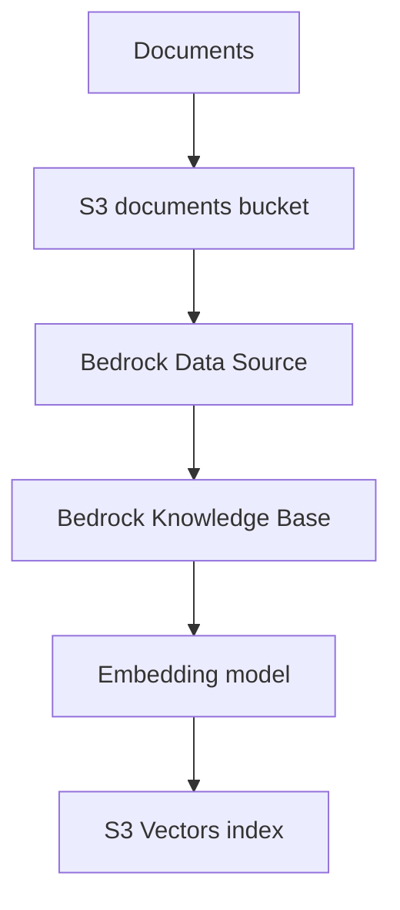

# terraform-aws-bedrock-vector-kb

Terraform module for provisioning Amazon Bedrock Knowledge Bases backed by
Amazon S3 Vectors, with S3 document storage and scoped IAM.

## Architecture



Amazon S3 Vectors is the vector store this module provisions and wires the
Knowledge Base to (either creating a new vector bucket/index, or referencing
an existing one). There is no built-in support for OpenSearch Serverless,
Pinecone, or any other vector store backend.

## Features

Only behavior that is actually implemented:

- Multiple Knowledge Base definitions through a single map input (`kbs`)
- Managed S3 Vectors bucket + index, or bring-your-own existing S3 Vectors
  index ARN
- A dedicated S3 bucket per Knowledge Base for source documents
- Optional chunking configuration (fixed-size, hierarchical, semantic, or no
  chunking), with validation of AWS's documented per-strategy constraints
- Embedding model / vector dimension compatibility validation for
  AWS-documented models, with forward compatibility for unrecognized models
  and an explicit opt-out escape hatch
- Optional, per-KB IAM policy document (JSON, not created or attached) with
  the minimal permissions an external actor needs to start and monitor
  ingestion jobs
- Knowledge Base / data source status outputs and data source ID outputs,
  reflecting the most recently refreshed Terraform state (not continuous
  monitoring)
- Optional per-KB ingestion log delivery (`APPLICATION_LOGS`) to an
  existing CloudWatch Logs, S3, or Data Firehose destination you already
  own - this module never creates the destination itself
- Bucket versioning
- S3 Block Public Access enforced on the documents bucket
- TLS-only access enforced on the documents bucket via a bucket policy
- Incomplete multipart upload cleanup (always on)
- Optional noncurrent-version retention (opt-in)
- Optional SSE-KMS encryption, bring your own key (SSE-S3/AES256 by default)
- Optional S3 server access logging to an existing external bucket
- Scoped IAM role and policies for the Bedrock execution role (invoke model,
  read S3 documents, S3 Vectors index access, and optional KMS access)
- A native `terraform test` suite (mock-provider based; no AWS credentials
  required to run it)

## Requirements

This module's own runtime requirement is whatever `versions.tf` declares
(see the generated table below).

Running the native test suite locally is a separate, stricter requirement:
`terraform test` mocking (`mock_provider`) was introduced in Terraform
1.7.0, so contributors need Terraform >= 1.7.0 to run `terraform test`, even
though the module's declared `required_version` floor remains `>= 1.5.0` for
consumers who never run these tests. See [CONTRIBUTING.md](CONTRIBUTING.md).

<!-- BEGIN_TF_DOCS -->
## Requirements

| Name | Version |
| ---- | ------- |
| <a name="requirement_terraform"></a> [terraform](#requirement\_terraform) | >= 1.5.0 |
| <a name="requirement_aws"></a> [aws](#requirement\_aws) | ~> 6.24 |
| <a name="requirement_awscc"></a> [awscc](#requirement\_awscc) | ~> 1.0 |

## Providers

| Name | Version |
| ---- | ------- |
| <a name="provider_aws"></a> [aws](#provider\_aws) | 6.62.0 |
| <a name="provider_awscc"></a> [awscc](#provider\_awscc) | 1.99.0 |

## Resources

| Name | Type |
| ---- | ---- |
| [aws_cloudwatch_log_delivery.ingestion](https://registry.terraform.io/providers/hashicorp/aws/latest/docs/resources/cloudwatch_log_delivery) | resource |
| [aws_cloudwatch_log_delivery_source.ingestion](https://registry.terraform.io/providers/hashicorp/aws/latest/docs/resources/cloudwatch_log_delivery_source) | resource |
| [aws_iam_policy.bedrock_invoke_model](https://registry.terraform.io/providers/hashicorp/aws/latest/docs/resources/iam_policy) | resource |
| [aws_iam_policy.kb_s3_kms](https://registry.terraform.io/providers/hashicorp/aws/latest/docs/resources/iam_policy) | resource |
| [aws_iam_policy.kb_s3_read](https://registry.terraform.io/providers/hashicorp/aws/latest/docs/resources/iam_policy) | resource |
| [aws_iam_policy.s3vectors](https://registry.terraform.io/providers/hashicorp/aws/latest/docs/resources/iam_policy) | resource |
| [aws_iam_role.bedrock_kb](https://registry.terraform.io/providers/hashicorp/aws/latest/docs/resources/iam_role) | resource |
| [aws_iam_role_policy_attachment.invoke_model](https://registry.terraform.io/providers/hashicorp/aws/latest/docs/resources/iam_role_policy_attachment) | resource |
| [aws_iam_role_policy_attachment.s3_kms](https://registry.terraform.io/providers/hashicorp/aws/latest/docs/resources/iam_role_policy_attachment) | resource |
| [aws_iam_role_policy_attachment.s3_read](https://registry.terraform.io/providers/hashicorp/aws/latest/docs/resources/iam_role_policy_attachment) | resource |
| [aws_iam_role_policy_attachment.s3vectors](https://registry.terraform.io/providers/hashicorp/aws/latest/docs/resources/iam_role_policy_attachment) | resource |
| [aws_s3_bucket.kb_docs](https://registry.terraform.io/providers/hashicorp/aws/latest/docs/resources/s3_bucket) | resource |
| [aws_s3_bucket_lifecycle_configuration.kb_docs](https://registry.terraform.io/providers/hashicorp/aws/latest/docs/resources/s3_bucket_lifecycle_configuration) | resource |
| [aws_s3_bucket_logging.kb_docs](https://registry.terraform.io/providers/hashicorp/aws/latest/docs/resources/s3_bucket_logging) | resource |
| [aws_s3_bucket_policy.kb_docs_tls_only](https://registry.terraform.io/providers/hashicorp/aws/latest/docs/resources/s3_bucket_policy) | resource |
| [aws_s3_bucket_public_access_block.kb_docs](https://registry.terraform.io/providers/hashicorp/aws/latest/docs/resources/s3_bucket_public_access_block) | resource |
| [aws_s3_bucket_server_side_encryption_configuration.kb_docs](https://registry.terraform.io/providers/hashicorp/aws/latest/docs/resources/s3_bucket_server_side_encryption_configuration) | resource |
| [aws_s3_bucket_versioning.kb_docs](https://registry.terraform.io/providers/hashicorp/aws/latest/docs/resources/s3_bucket_versioning) | resource |
| [aws_s3vectors_index.this](https://registry.terraform.io/providers/hashicorp/aws/latest/docs/resources/s3vectors_index) | resource |
| [aws_s3vectors_vector_bucket.this](https://registry.terraform.io/providers/hashicorp/aws/latest/docs/resources/s3vectors_vector_bucket) | resource |
| [awscc_bedrock_data_source.s3](https://registry.terraform.io/providers/hashicorp/awscc/latest/docs/resources/bedrock_data_source) | resource |
| [awscc_bedrock_knowledge_base.this](https://registry.terraform.io/providers/hashicorp/awscc/latest/docs/resources/bedrock_knowledge_base) | resource |

## Inputs

| Name | Description | Type | Default | Required |
| ---- | ----------- | ---- | ------- | :------: |
| <a name="input_enable_kbs"></a> [enable\_kbs](#input\_enable\_kbs) | If false, nothing is created. | `bool` | `true` | no |
| <a name="input_kbs"></a> [kbs](#input\_kbs) | Knowledge Bases definition map. | <pre>map(object({<br/>    kb_name             = string<br/>    role_name           = string<br/>    kb_description      = optional(string)<br/>    embedding_model_arn = string<br/><br/>    # Explicit escape hatch for the compatibility check below (see<br/>    # known_embedding_model_dimensions). Only meaningful for a model this<br/>    # module already recognizes: set to true when the maintained map is<br/>    # stale (AWS expanded the model's valid dimensions, or documentation<br/>    # changed before this module was updated) and you have independently<br/>    # confirmed the pair is valid. Unknown/future models never need this -<br/>    # they already pass automatically since the module cannot validate what<br/>    # it doesn't recognize.<br/>    skip_dimension_validation = optional(bool, false)<br/><br/>    # When true, this module computes (but does not create or attach) an<br/>    # IAM policy document (see output "ingestion_policy_documents")<br/>    # granting the minimal permissions an external actor needs to manage<br/>    # ingestion jobs for this KB: bedrock:StartIngestionJob,<br/>    # GetIngestionJob, ListIngestionJobs, scoped to this KB's own ARN. This<br/>    # module never calls StartIngestionJob itself and never attaches this<br/>    # document to any principal - see "Bedrock / Ingestion Boundary" in the<br/>    # README for why, and for who should use the resulting document.<br/>    expose_ingestion_policy = optional(bool, false)<br/><br/>    # When set, this module creates an AWS Logs vended-log delivery pipe<br/>    # (aws_cloudwatch_log_delivery_source + aws_cloudwatch_log_delivery) for<br/>    # this KB's APPLICATION_LOGS (ingestion/document-status events), sending<br/>    # them to an EXISTING delivery destination the caller already owns. This<br/>    # module never creates the destination (CloudWatch Logs, S3, or Data<br/>    # Firehose) or an aws_cloudwatch_log_delivery_destination resource -<br/>    # only the source and the source-to-destination link. Default null<br/>    # (omitted) creates neither resource. See the README's "Ingestion Log<br/>    # Delivery" section.<br/>    ingestion_logging = optional(object({<br/>      delivery_destination_arn = string<br/>    }))<br/><br/>    # Docs source<br/>    content_bucket = string<br/>    content_prefix = optional(string, "")<br/><br/>    # Chunking strategy for this data source's ingestion. null (default,<br/>    # omitted) sends no vector_ingestion_configuration at all, so AWS<br/>    # applies its own default chunking behavior unchanged from v0.1.0.<br/>    # Exactly the block matching `strategy` may be set (enforced below):<br/>    #   FIXED_SIZE   -> fixed_size<br/>    #   HIERARCHICAL -> hierarchical<br/>    #   SEMANTIC     -> semantic<br/>    #   NONE         -> none of the three<br/>    chunking = optional(object({<br/>      strategy = string<br/><br/>      fixed_size = optional(object({<br/>        max_tokens         = number<br/>        overlap_percentage = number<br/>      }))<br/><br/>      hierarchical = optional(object({<br/>        level_configurations = list(object({<br/>          max_tokens = number<br/>        }))<br/>        overlap_tokens = number<br/>      }))<br/><br/>      semantic = optional(object({<br/>        max_tokens                      = number<br/>        buffer_size                     = number<br/>        breakpoint_percentile_threshold = number<br/>      }))<br/>    }), null)<br/><br/>    # S3 Vectors: either create it, or provide an existing index ARN.<br/>    create_s3vectors          = optional(bool, false)<br/>    s3vectors_bucket_name     = optional(string)<br/>    s3vectors_index_name      = optional(string)<br/>    s3vectors_dimension       = optional(number, 1024)<br/>    s3vectors_distance_metric = optional(string, "cosine")  # cosine|euclidean<br/>    s3vectors_data_type       = optional(string, "float32") # currently float32<br/>    s3vectors_index_arn       = optional(string)            # used when create_s3vectors=false<br/><br/>    # Docs bucket encryption: bring your own KMS key. Default (null) keeps<br/>    # the existing SSE-S3 (AES256) behavior unchanged. Granting this<br/>    # module's IAM policy kms:Decrypt/kms:GenerateDataKey is not, by<br/>    # itself, sufficient - the key's own key policy must also allow the<br/>    # Bedrock execution role (this module does not manage the key or its<br/>    # key policy, since it only accepts an existing key ARN).<br/>    kms_key_arn = optional(string)<br/><br/>    # Docs bucket access logging: bring your own existing logging-destination<br/>    # bucket. Default (null) leaves logging disabled, unchanged from before.<br/>    # This module does not create or configure the destination bucket -<br/>    # it must already be set up to accept S3 access log delivery.<br/>    logging_target_bucket = optional(string)<br/>    logging_target_prefix = optional(string, "")<br/><br/>    # Docs bucket lifecycle: noncurrent object versions are kept forever<br/>    # unless this is set. null (default) = no automatic deletion of old<br/>    # versions, unchanged from before. When set, noncurrent versions older<br/>    # than this many days are expired. This is destructive retention<br/>    # behavior (it permanently deletes old version content, even though it<br/>    # never touches the current/live version) and is therefore<br/>    # consumer-opt-in only, never a default.<br/>    noncurrent_version_expiration_days = optional(number)<br/>  }))</pre> | n/a | yes |
| <a name="input_tags"></a> [tags](#input\_tags) | Extra tags. | `map(string)` | `{}` | no |

## Outputs

| Name | Description |
| ---- | ----------- |
| <a name="output_data_source_ids"></a> [data\_source\_ids](#output\_data\_source\_ids) | Bedrock data source IDs by kbs key. Combined with knowledge\_base\_ids, this gives an external actor everything StartIngestionJob's required knowledgeBaseId/dataSourceId path parameters need - this module does not call StartIngestionJob itself (see the README's "Bedrock / Ingestion Boundary" section); it only exposes the identifiers that workflow requires. |
| <a name="output_data_source_statuses"></a> [data\_source\_statuses](#output\_data\_source\_statuses) | Bedrock data source status by key (AVAILABLE, DELETING, DELETE\_UNSUCCESSFUL, CREATING, UPDATING, or FAILED). Reflects the most recently refreshed Terraform state, the same point-in-time caveat as knowledge\_base\_statuses applies - not continuous monitoring, polling, or a real-time health check. |
| <a name="output_iam_role_arns"></a> [iam\_role\_arns](#output\_iam\_role\_arns) | IAM Role ARNs used by each KB. |
| <a name="output_ingestion_log_delivery_arns"></a> [ingestion\_log\_delivery\_arns](#output\_ingestion\_log\_delivery\_arns) | ARNs of the aws\_cloudwatch\_log\_delivery resources (the source-to-destination link) created for this KB's ingestion log delivery, keyed by kbs entry. Only present for entries with ingestion\_logging set. |
| <a name="output_ingestion_log_delivery_source_arns"></a> [ingestion\_log\_delivery\_source\_arns](#output\_ingestion\_log\_delivery\_source\_arns) | ARNs of the aws\_cloudwatch\_log\_delivery\_source resources created for this KB's APPLICATION\_LOGS (ingestion/document-status events), keyed by kbs entry. Only present for entries with ingestion\_logging set. This module never creates the delivery destination - see the README's "Ingestion Log Delivery" section. |
| <a name="output_ingestion_policy_documents"></a> [ingestion\_policy\_documents](#output\_ingestion\_policy\_documents) | IAM policy documents (JSON), keyed by kbs entry, granting the minimal permissions (bedrock:StartIngestionJob, GetIngestionJob, ListIngestionJobs) an external actor needs to manage ingestion for that KB, scoped to its ARN. Only present for kbs entries with expose\_ingestion\_policy = true; this module does not create or attach any IAM resource from this document itself - attach it (as a managed or inline policy) to whatever principal is responsible for triggering and monitoring ingestion. See the README's "Bedrock / Ingestion Boundary" section. |
| <a name="output_knowledge_base_arns"></a> [knowledge\_base\_arns](#output\_knowledge\_base\_arns) | Bedrock Knowledge Base ARNs by key (when available in awscc). |
| <a name="output_knowledge_base_ids"></a> [knowledge\_base\_ids](#output\_knowledge\_base\_ids) | Bedrock Knowledge Base IDs by key. |
| <a name="output_knowledge_base_statuses"></a> [knowledge\_base\_statuses](#output\_knowledge\_base\_statuses) | Bedrock Knowledge Base status by key (e.g. ACTIVE, CREATING, UPDATING, FAILED, DELETING, DELETE\_UNSUCCESSFUL, UPDATE\_UNSUCCESSFUL). Reflects the most recently refreshed Terraform state - it is a point-in-time value captured during refresh/plan/apply, not continuous monitoring, polling, or a real-time health check. Re-run terraform plan/apply (or terraform refresh) to get a current value; between runs this output can be stale. |
| <a name="output_s3vectors_index_arns"></a> [s3vectors\_index\_arns](#output\_s3vectors\_index\_arns) | Resolved S3 Vectors index ARNs by key. |
<!-- END_TF_DOCS -->

`knowledge_base_arns` returns each Knowledge Base's real ARN, keyed by `kbs`
entry. Prior to this fix it referenced a nonexistent provider attribute and
silently returned `null` for every entry - see the Changelog's `[0.2.0]`
`### Fixed` entry.

## Usage

A complete, runnable configuration lives in
[`examples/basic`](examples/basic/main.tf) - the excerpts below show the
same module inputs in isolation.

The simplest usable Knowledge Base, creating its own S3 Vectors store:

```hcl
module "bedrock_kb" {
  source = "github.com/IngMatrix-PGB/terraform-aws-bedrock-vector-kb"

  kbs = {
    default = {
      kb_name             = "my-knowledge-base"
      role_name           = "my-knowledge-base-role"
      embedding_model_arn = "arn:aws:bedrock:us-east-1::foundation-model/amazon.titan-embed-text-v2:0"

      content_bucket = "my-org-kb-documents"

      create_s3vectors      = true
      s3vectors_bucket_name = "my-org-kb-vector-store"
      s3vectors_index_name  = "my-org-kb-vector-index"
    }
  }
}
```

### Using an existing S3 Vectors index

```hcl
kbs = {
  default = {
    kb_name             = "my-knowledge-base"
    role_name           = "my-knowledge-base-role"
    embedding_model_arn = "arn:aws:bedrock:us-east-1::foundation-model/amazon.titan-embed-text-v2:0"
    content_bucket      = "my-org-kb-documents"

    create_s3vectors    = false
    s3vectors_index_arn = "arn:aws:s3vectors:us-east-1:123456789012:bucket/existing-bucket/index/existing-index"
  }
}
```

### SSE-KMS (bring your own key)

```hcl
kbs = {
  default = {
    # ...required fields as above...
    kms_key_arn = "arn:aws:kms:us-east-1:123456789012:key/your-key-id"
  }
}
```

### Access logging (bring your own destination bucket)

```hcl
kbs = {
  default = {
    # ...required fields as above...
    logging_target_bucket = "my-org-access-logs"
    logging_target_prefix = "kb-documents/"
  }
}
```

### Optional noncurrent-version retention

```hcl
kbs = {
  default = {
    # ...required fields as above...
    noncurrent_version_expiration_days = 30
  }
}
```

### Chunking

```hcl
kbs = {
  default = {
    # ...required fields as above...

    chunking = {
      strategy = "FIXED_SIZE"
      fixed_size = {
        max_tokens         = 512
        overlap_percentage = 20
      }
    }
  }
}
```

Omitting `chunking` (the default) sends no chunking configuration at all, so
AWS applies its own default (~300 tokens per chunk, sentence-boundary aware)
- identical to this module's behavior before this field existed. See
"Chunking" below for the full strategy reference and replacement semantics.

### Bypassing embedding model / dimension validation

```hcl
kbs = {
  default = {
    # ...required fields as above...
    embedding_model_arn       = "arn:aws:bedrock:us-east-1::foundation-model/amazon.titan-embed-text-v2:0"
    s3vectors_dimension       = 1536
    skip_dimension_validation = true
  }
}
```

Only needed when this module's known-model map is stale for a model it
already recognizes (see "Embedding Model / Dimension Compatibility" below).
Models this module doesn't recognize never need this flag - they already
pass validation automatically.

## KMS Boundary

`kms_key_arn` is bring-your-own-key: this module never creates or manages a
KMS key. When set, the module grants the Bedrock execution role
`kms:Decrypt` and `kms:GenerateDataKey`, scoped to exactly that key ARN.
That identity-policy grant is necessary but **not sufficient** on its own -
the external key's own key policy must separately allow the Bedrock
execution role. Passing `kms_key_arn` does not, by itself, guarantee
successful KMS access; the key policy is the consumer's responsibility.

## Logging Boundary

`logging_target_bucket` is bring-your-own: this module never creates or
configures the destination logging bucket. The consumer is responsible for
ensuring that destination bucket is set up to accept S3 server access log
delivery (the appropriate bucket policy/permissions for the S3 log delivery
service). If it isn't, log delivery will simply fail silently on the AWS
side - this module cannot detect or prevent that.

## Lifecycle Semantics

**Always enabled**, with no opt-out:
- Abort incomplete multipart uploads after 7 days.

**Opt-in only**, via `noncurrent_version_expiration_days`:
- Noncurrent-version expiration. `null` (the default) means this module
  preserves noncurrent object versions indefinitely - it never deletes them
  on its own. Setting this to a number of days is genuinely destructive
  retention behavior: it permanently deletes old version content once it
  ages past that threshold. It never touches the current/live version of an
  object, but the deletion of noncurrent versions themselves is real and
  irreversible, which is why it is opt-in rather than a default.

## Chunking

`kbs[*].chunking` (optional, default `null`) configures how Bedrock splits
documents into chunks before embedding them. Supported strategies, per the
`awscc_bedrock_data_source` provider schema:

| Strategy | Sub-block | Required fields | Ranges |
|---|---|---|---|
| `FIXED_SIZE` | `fixed_size` | `max_tokens`, `overlap_percentage` | `max_tokens` 1-8192, `overlap_percentage` 1-99 |
| `HIERARCHICAL` | `hierarchical` | `level_configurations` (exactly 2 entries, each `{ max_tokens }`), `overlap_tokens` | `overlap_tokens` >= 1, each level's `max_tokens` >= 1 |
| `SEMANTIC` | `semantic` | `max_tokens`, `buffer_size`, `breakpoint_percentile_threshold` | `max_tokens` 1-8192, `buffer_size` 0-1, `breakpoint_percentile_threshold` 50-99 |
| `NONE` | (none) | - | - |

Exactly the sub-block matching `strategy` may be set; all others must be
omitted. This exclusivity and the ranges above are enforced by this
module's own `variable "kbs"` validation - the AWS API and the
`awscc`/CloudFormation schemas only document these constraints in prose and
accept invalid combinations until `apply` time, where they surface as an
opaque `ValidationException`. Failing at `terraform plan` with a clear
message is strictly better.

For `HIERARCHICAL`, AWS requires exactly 2 `level_configurations` but does
not document an ordering requirement between them; by convention, list the
broader/parent level first and the narrower/child level second, but this
module does not enforce that order.

Omitting `chunking` entirely (the default) sends no
`vector_ingestion_configuration` argument to `awscc_bedrock_data_source`, so
AWS applies its own default chunking behavior (~300 tokens per chunk,
respecting sentence boundaries) - unchanged from this module's behavior
before this field existed.

**Replacement semantics:** per the `AWS::Bedrock::DataSource` CloudFormation
resource schema, `ChunkingConfiguration` is a `createOnlyProperty`. Changing
`chunking` on an existing `kbs` entry - including adding it where it was
previously omitted, or removing it - forces `awscc` to **replace** the
underlying data source resource, not update it in place. Replacing the data
source does **not** automatically re-run ingestion: any documents already
ingested under the old data source are not retained or re-ingested
automatically; a new `StartIngestionJob` against the new data source is
required (see "Bedrock / Ingestion Boundary" below). This module does not
use `lifecycle { prevent_destroy = true }` to mask this behavior - plan
output will show the replacement plainly before you apply it.

## Embedding Model / Dimension Compatibility

Amazon Bedrock rejects an embedding model / vector dimension pair it
doesn't support only at `apply` time (`CreateKnowledgeBase` /
`UpdateKnowledgeBase` `ValidationException`), with no dry-run available and
no dynamic AWS API this module could query to check compatibility ahead of
time - neither `GetFoundationModel`/`ListFoundationModels` nor Terraform's
own `aws_bedrock_foundation_model` data source expose a "supported output
dimensions" field for any model, at all. This module closes part of that gap
by validating each `kbs` entry's `embedding_model_arn` /
`s3vectors_dimension` pair against a small internal map of models AWS
documents as supported for Knowledge Bases' vector embeddings, at
`terraform plan` time, before anything is created.

This map is a point-in-time snapshot of AWS's own [Knowledge Bases
supported-models documentation](https://docs.aws.amazon.com/bedrock/latest/userguide/knowledge-base-supported.html),
current as of this module's PR #11 - **not** an exhaustive or permanent
list. AWS adds embedding models and expands dimension options over time.
Three behaviors follow directly from that:

- A **known** model with a **known-invalid** dimension fails at `plan`
  time with a specific, actionable error (naming the model, the configured
  dimension, and the allowed dimensions) instead of a generic
  `ValidationException` at `apply`.
- An **unknown** model (anything not in this module's map - including any
  model AWS releases after this module was last updated) always **passes**
  validation unconditionally. This module has no way to know whether a
  model it has never heard of is compatible with a given dimension, so it
  does not guess either way; catching that class of mistake is left to AWS
  itself at `apply` time, same as before this validation existed.
- `skip_dimension_validation` (per `kbs` entry, default `false`) is an
  explicit escape hatch for a model this module **does** recognize, for
  when the map is stale - AWS expanded a model's valid dimensions, or
  documentation changed before this module was updated. It does not exist
  to bypass validation for unknown models; those already pass without it.

Models currently in the map:

| Model ID | KB-supported dimensions |
|---|---|
| `amazon.titan-embed-text-v1` | 1536 |
| `amazon.titan-embed-text-v2:0` | 256, 512, 1024 |
| `cohere.embed-english-v3` | 1024 |
| `cohere.embed-multilingual-v3` | 1024 |
| `amazon.titan-embed-image-v1` | 1024 |
| `amazon.nova-2-multimodal-embeddings-v1:0` | 1024 |

Deliberately **not** included, despite appearing adjacent to this list in
AWS's own documentation: Cohere Embed v4 (model ID rendered inconsistently
across AWS's docs, and absent from the Knowledge Bases model/ID table
itself) and a "Cohere Embed v3 (Multimodal)" row that appears in the
Knowledge Bases dimensions table but has no corresponding model card or
model ID anywhere in Bedrock's own model catalog. Both are left out rather
than guessed at.

**A note on `amazon.nova-2-multimodal-embeddings-v1:0` specifically:** its
own Bedrock model card lists "Knowledge base" as an unsupported feature in
its general `bedrock-runtime` capability matrix. That capability matrix
describes using a model as the *generation* model inside a Knowledge
Base's `RetrieveAndGenerate` call, which requires text output - this model
is embedding-only, so it cannot serve that role, unrelated to whether it is
usable as the *embedding* model behind a Knowledge Base's vector index.
The claim of KB compatibility in the table above is scoped specifically to
that narrower, embedding-model question, sourced from Bedrock's dedicated
[Knowledge Bases supported-embedding-models
documentation](https://docs.aws.amazon.com/bedrock/latest/userguide/knowledge-base-supported.html#knowledge-base-supported-embeddings),
which does list it. This module does not claim the model is universally
supported across all Bedrock Knowledge Base execution paths - only that it
is documented as an eligible embedding model. It remains in the map on that
basis; it would be removed only if newer official AWS evidence directly
contradicted its eligibility as a KB embedding model, not merely on the
strength of this one capability-matrix flag, which describes a different
capability.

## Bedrock / Ingestion Boundary

Terraform provisions Bedrock Knowledge Base **infrastructure** (the
Knowledge Base, the S3 Vectors store, the documents bucket, the data
source, IAM). It does **not** run ingestion, and it never will as a
`terraform apply` side effect - this is a deliberate architectural boundary,
not a gap this module is working toward closing.

Concretely, none of the following ever trigger ingestion:

- `terraform apply` itself, whether creating or updating any resource.
- Uploading, modifying, or deleting objects in the documents S3 bucket.
  Amazon Bedrock does not watch the bucket; nothing observes S3 events.
- Changing a `kbs` entry's `chunking` configuration. Even though this
  replaces the underlying data source (see "Chunking" above), the
  replacement itself does not re-ingest previously-ingested content.
- Creating the Knowledge Base or the data source for the first time.

`StartIngestionJob` is Bedrock's own imperative, one-shot API action - it
has no declarative Terraform resource in `hashicorp/aws` or
`hashicorp/awscc`, and no equivalent CloudFormation resource type exists
either, so `awscc` cannot gain one either. Every time documents in the
source bucket are added, modified, or removed, a new ingestion job must be
started explicitly (console, CLI, or SDK) to pick up the change. This
module does not use `null_resource`, `local-exec`, `remote-exec`, AWS CLI
invocations, Lambda, EventBridge, or Step Functions to work around that -
seemingly working around it would mean silently reintroducing the exact
imperative-inside-declarative anti-pattern this boundary exists to avoid
(see "Security Decisions" below for the concurrency/rate-limit reasons this
is also operationally the wrong place for it).

A typical external ingestion workflow, entirely outside this module and
outside Terraform's state:

```
terraform apply                    (provisions/updates KB infrastructure)
        |
        v
upload/update documents in S3       (this module's content_bucket)
        |
        v
StartIngestionJob                   (external actor: CI, app, Lambda, operator)
        |
        v
GetIngestionJob / ListIngestionJobs  (poll until COMPLETE or FAILED)
        |
        v
application retrieval                (Retrieve / RetrieveAndGenerate)
```

### Optional IAM support for that external workflow

This module can compute (but never creates or attaches) an IAM policy
document granting exactly the permissions that external workflow's "start
and monitor" step needs. Set `expose_ingestion_policy = true` on a `kbs`
entry to populate that entry's key in the `ingestion_policy_documents`
output:

```hcl
kbs = {
  default = {
    # ...required fields as above...
    expose_ingestion_policy = true
  }
}
```

What this does and does not do:

- **Creates:** nothing. `expose_ingestion_policy` computes a JSON policy
  document as a plain Terraform value (`jsonencode(...)`) - no
  `aws_iam_policy`, no attachment, no AWS API call. Omitting it (the
  default) leaves the output empty for that entry, exactly as before this
  field existed.
- **Does not attach to anything.** In particular, it is **not** added to
  this module's own Bedrock execution role
  (`aws_iam_role.bedrock_kb`/`iam_role_arns` output). That role is assumed
  *by the Bedrock service itself* to do its own internal work once an
  ingestion job is already running (invoke the embedding model, read S3
  documents, write to the vector store) - it is never the caller of
  `StartIngestionJob`, `GetIngestionJob`, or `ListIngestionJobs`. Those
  actions are called by whatever external principal (a CI role, an
  application role, a Lambda execution role, an operator's role) actually
  triggers and monitors ingestion, which this module cannot know and does
  not try to guess. Attach the resulting document (as a managed or inline
  policy) to whichever principal that is, in your own Terraform
  configuration or IAM tooling.
- **Grants exactly:** `bedrock:StartIngestionJob`, `bedrock:GetIngestionJob`,
  `bedrock:ListIngestionJobs`, scoped to that KB's own ARN (the real
  `knowledge_base_arn` attribute, not a hand-constructed string, so it is
  automatically correct for the deployed partition - `aws`, `aws-us-gov`,
  or `aws-cn`). Per AWS's IAM Service Authorization Reference for Amazon
  Bedrock, all three actions support resource-level permissions scoped only
  to the `knowledge-base` resource type - there is no finer-grained
  data-source- or ingestion-job-level ARN to scope to instead. This module
  currently creates exactly one data source per KB, but the scoping
  limit is AWS's own (any principal granted this policy can start/monitor
  ingestion for *any* data source under that KB, not a specific one) - not
  something this module chooses or could narrow further.
- **Never includes** `bedrock:*`, `s3:*`, `kms:*`, or any other wildcard
  action, regardless of whether the KB uses KMS, chunking, or anything
  else configured elsewhere in that same `kbs` entry.

## Ingestion Log Delivery

Amazon Bedrock Knowledge Bases can deliver `APPLICATION_LOGS` (per-document
ingestion status events - embedding started/completed/failed, indexing
started/completed/failed, and similar) through AWS's generic CloudWatch
Logs vended-log-delivery framework. This is infrastructure *configuration*,
not ingestion monitoring itself: **Terraform is not polling or watching
ingestion jobs here** - it is provisioning the pipe logs would flow
through, if and when an ingestion job runs (see "Bedrock / Ingestion
Boundary" above for the boundary on triggering/monitoring ingestion
itself). This is a distinct concept from the "Operational Status Outputs"
below: those reflect Terraform's own refresh-time state of the KB/data
source resources; `APPLICATION_LOGS` are operational ingestion/document
events delivered externally, by AWS, outside Terraform's state entirely.

**Ownership boundary:** this module creates exactly two resources per
opted-in `kbs` entry:
- `aws_cloudwatch_log_delivery_source` - registers the KB itself (by its
  real `knowledge_base_arn`) as a source of `APPLICATION_LOGS`.
- `aws_cloudwatch_log_delivery` - links that source to a destination.

This module **never creates** the delivery destination - no
`aws_cloudwatch_log_delivery_destination`, no CloudWatch Logs log group, no
S3 bucket, no Data Firehose stream, and no destination policy. You supply
an **existing** destination's ARN; AWS itself requires that destination to
already exist (it is never auto-provisioned), so there is nothing for this
module to bootstrap even if it wanted to.

**Delivery source naming:** the delivery source is named deterministically
as `"${kb_name}-ingestion-logs"` - no random suffix. `PutDeliverySource`
requires this name to be 1-60 characters, matching `[\w-]*` (letters,
digits, underscore, hyphen), and unique across all delivery sources in
your account/region. This module validates the derived name's length at
`terraform plan` time when `ingestion_logging` is set (`kb_name` itself has
no length limit of its own beyond AWS's 100-character KB name limit, so a
long `kb_name` plus the `-ingestion-logs` suffix can exceed 60 characters -
shorten `kb_name` for that entry if this happens). A charset check exists
too, but is effectively unreachable in practice: `kb_name` itself is
already constrained by `awscc_bedrock_knowledge_base`'s own name pattern
(`^([0-9a-zA-Z][_-]?){1,100}$`), whose character set is always a subset of
`[\w-]*` - there is no `kb_name` value the KB resource itself would accept
that could fail this derived-name check on character content alone.

```hcl
kbs = {
  default = {
    # ...required fields as above...

    ingestion_logging = {
      delivery_destination_arn = "arn:aws:logs:us-east-1:123456789012:delivery-destination:my-existing-destination"
    }
  }
}
```

Omitting `ingestion_logging` (the default) creates neither resource.

**Destinations**: CloudWatch Logs, S3, and Data Firehose are all supported
- AWS infers the destination type from the ARN itself, so this module has
no separate "destination type" field to set. **Same-account only** for
now; cross-account delivery (which needs a
`PutDeliveryDestinationPolicy`-configured resource policy on the
destination) is not implemented.

**Shared destinations are explicitly supported, with no special
configuration.** AWS's own API is designed so that multiple delivery
sources can send to the same delivery destination - two (or more) `kbs`
entries may intentionally set the identical `delivery_destination_arn`:

```hcl
kbs = {
  a = { # ...
    ingestion_logging = { delivery_destination_arn = "arn:aws:logs:us-east-1:123456789012:delivery-destination:shared" }
  }
  b = { # ...
    ingestion_logging = { delivery_destination_arn = "arn:aws:logs:us-east-1:123456789012:delivery-destination:shared" }
  }
}
```
This creates two independent `aws_cloudwatch_log_delivery_source`/
`aws_cloudwatch_log_delivery` pairs (one per KB, as always), both pointing
at the one destination you already own - no deduplication logic is needed
or attempted, since the module never owned that shared resource in the
first place.

`ingestion_log_delivery_source_arns` and `ingestion_log_delivery_arns`
expose the two created resources' ARNs, keyed by `kbs` entry, for anyone
building their own auditing/monitoring around this (e.g. calling
`logs:GetDeliverySource`/`logs:GetDelivery` directly, or referencing these
ARNs in their own IAM policies).

### Apply-time permissions for ingestion logging

Creating these two resources requires the identity running `terraform
apply` (not this module's Bedrock execution role, and not a principal this
module creates) to hold, at minimum:

- `bedrock:AllowVendedLogDeliveryForResource`, scoped to the specific KB
  ARN - AWS classifies this as a permissions-management action, checked
  when `PutDeliverySource` names that KB as the source resource.
- `logs:PutDeliverySource`, `logs:GetDeliverySource`,
  `logs:DeleteDeliverySource`, scoped to the delivery-source ARN this
  module will create (`arn:aws:logs:<region>:<account>:delivery-source:<kb_name>-ingestion-logs`).
- `logs:CreateDelivery`, `logs:GetDelivery`, `logs:DeleteDelivery`, which
  need the delivery, delivery-destination, *and* delivery-source ARNs
  together.
- Whatever permission the destination itself requires to be named in a
  delivery (e.g. `logs:PutDeliveryDestination` is **not** needed by this
  module since it never creates a destination, but the destination's own
  owner may separately need it when *they* set it up).

This module does not grant any of these - they are prerequisites for
whoever runs `terraform apply`, exactly like the S3/IAM/KMS permissions
already required to create every other resource in this module. Do not
attach these to `aws_iam_role.bedrock_kb`; that role is never the caller of
any of these APIs.

## Operational Status Outputs

`knowledge_base_statuses` and `data_source_statuses` expose each resource's
`status`/`data_source_status` attribute, keyed by `kbs` entry. Both are
plain computed-attribute passthroughs - no polling, no new IAM, no new AWS
resource.

**Status outputs reflect the most recently refreshed Terraform state and
should not be treated as continuous monitoring.** Terraform captures these
values during `refresh`/`plan`/`apply` - the value can be stale the moment
the run finishes if the underlying resource's real AWS state changes
afterward (for example, a Knowledge Base transitioning to `FAILED` between
one `apply` and the next). Re-run `terraform plan` or `terraform refresh`
to get a current value. These are not real-time status, not live health,
and not a substitute for actual monitoring - see "Bedrock / Ingestion
Boundary" above for what this module deliberately does not do
(CloudWatch/CloudTrail/EventBridge integration is a separate, future
concern, not implemented by this output).

Documented status values, per AWS's current API reference (not
exhaustive-by-omission if AWS adds more later):
- Knowledge Base (`knowledge_base_statuses`): `CREATING`, `ACTIVE`,
  `DELETING`, `UPDATING`, `FAILED`, `DELETE_UNSUCCESSFUL`,
  `UPDATE_UNSUCCESSFUL`.
- Data source (`data_source_statuses`): `AVAILABLE`, `DELETING`,
  `DELETE_UNSUCCESSFUL`, `CREATING`, `UPDATING`, `FAILED`.

`data_source_ids` closes an operational gap left open by v0.2.0: an
external actor calling `StartIngestionJob` (see "Bedrock / Ingestion
Boundary" above) needs both `knowledgeBaseId` and `dataSourceId` as path
parameters. `knowledge_base_ids` already provided the former; this module
had no output for the latter until now. This output does not change the
ingestion boundary - Terraform still never calls `StartIngestionJob`
itself - it only gives the external workflow the second identifier that
workflow already required.

## Security Decisions

**Implemented:**
- S3 Block Public Access
- TLS-only bucket access
- Bucket versioning
- Encryption at rest (SSE-S3 by default, optional SSE-KMS)
- Optional S3 access logging

**Not automatically implemented:**
- Cross-region replication - this module has no disaster-recovery or
  multi-region contract; adding it would mean inventing a destination
  bucket, region, and IAM role with no consumer-driven requirement.
- S3 event notifications - Bedrock ingestion is triggered by
  `StartIngestionJob`, not by S3 events, and this module has no downstream
  consumer (queue, topic, function) for bucket notifications to reach.

These two are architecture/policy decisions for the consumer to make and
implement outside this module if their environment requires them, not gaps
this module leaves unaddressed by omission.

## Known Limitations

- Terraform never calls `StartIngestionJob`, `GetIngestionJob`, or
  `ListIngestionJobs` - see "Bedrock / Ingestion Boundary".
- No automatic S3 → Knowledge Base synchronization: adding, changing, or
  removing documents in the content bucket never triggers ingestion on its
  own.
- No automatic re-ingestion after a `chunking` change, even though that
  change replaces the underlying data source - see "Chunking".
- The embedding model / vector dimension compatibility map
  (`known_embedding_model_dimensions`) is a static, maintained snapshot by
  design, not a live query against AWS - see "Embedding Model / Dimension
  Compatibility".
- Unknown or future embedding models are allowed through validation
  unconditionally, by design - this module cannot validate what it doesn't
  recognize, and would rather stay usable than guess.
- `ingestion_policy_documents`' IAM scoping stops at the Knowledge Base
  ARN, not a specific data source, because AWS's IAM Service Authorization
  Reference does not expose a narrower resource type for
  `StartIngestionJob`/`GetIngestionJob`/`ListIngestionJobs`.
- No Guardrails, model evaluation, or advanced observability wiring beyond
  what's already listed under "Features".
- No cross-region replication or S3 event notifications for the documents
  bucket - see "Security Decisions".
- No built-in support for vector store backends other than Amazon S3
  Vectors (OpenSearch Serverless, Pinecone, etc.) - see "Architecture".

## Contributing

See [CONTRIBUTING.md](CONTRIBUTING.md) for the local development workflow
(formatting, validation, native tests, linting).

## License

[MIT](LICENSE)
