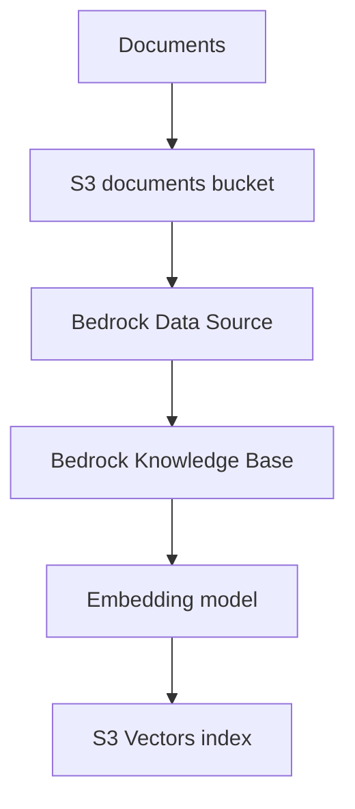

# terraform-aws-bedrock-vector-kb

Terraform module for provisioning Amazon Bedrock Knowledge Bases backed by
Amazon S3 Vectors, with S3 document storage and scoped IAM.

## Architecture



Amazon S3 Vectors is the vector store this module provisions and wires the
Knowledge Base to (either creating a new vector bucket/index, or referencing
an existing one). There is no built-in support for OpenSearch Serverless,
Pinecone, or any other vector store backend.

## Features

Only behavior that is actually implemented:

- Multiple Knowledge Base definitions through a single map input (`kbs`)
- Managed S3 Vectors bucket + index, or bring-your-own existing S3 Vectors
  index ARN
- A dedicated S3 bucket per Knowledge Base for source documents
- Bucket versioning
- S3 Block Public Access enforced on the documents bucket
- TLS-only access enforced on the documents bucket via a bucket policy
- Incomplete multipart upload cleanup (always on)
- Optional noncurrent-version retention (opt-in)
- Optional SSE-KMS encryption, bring your own key (SSE-S3/AES256 by default)
- Optional S3 server access logging to an existing external bucket
- Scoped IAM role and policies for the Bedrock execution role (invoke model,
  read S3 documents, S3 Vectors index access, and optional KMS access)
- A native `terraform test` suite (mock-provider based; no AWS credentials
  required to run it)

## Requirements

This module's own runtime requirement is whatever `versions.tf` declares
(see the generated table below).

Running the native test suite locally is a separate, stricter requirement:
`terraform test` mocking (`mock_provider`) was introduced in Terraform
1.7.0, so contributors need Terraform >= 1.7.0 to run `terraform test`, even
though the module's declared `required_version` floor remains `>= 1.5.0` for
consumers who never run these tests. See [CONTRIBUTING.md](CONTRIBUTING.md).

<!-- BEGIN_TF_DOCS -->
## Requirements

| Name | Version |
| ---- | ------- |
| <a name="requirement_terraform"></a> [terraform](#requirement\_terraform) | >= 1.5.0 |
| <a name="requirement_aws"></a> [aws](#requirement\_aws) | ~> 6.24 |
| <a name="requirement_awscc"></a> [awscc](#requirement\_awscc) | ~> 1.0 |

## Providers

| Name | Version |
| ---- | ------- |
| <a name="provider_aws"></a> [aws](#provider\_aws) | 6.62.0 |
| <a name="provider_awscc"></a> [awscc](#provider\_awscc) | 1.99.0 |

## Resources

| Name | Type |
| ---- | ---- |
| [aws_iam_policy.bedrock_invoke_model](https://registry.terraform.io/providers/hashicorp/aws/latest/docs/resources/iam_policy) | resource |
| [aws_iam_policy.kb_s3_kms](https://registry.terraform.io/providers/hashicorp/aws/latest/docs/resources/iam_policy) | resource |
| [aws_iam_policy.kb_s3_read](https://registry.terraform.io/providers/hashicorp/aws/latest/docs/resources/iam_policy) | resource |
| [aws_iam_policy.s3vectors](https://registry.terraform.io/providers/hashicorp/aws/latest/docs/resources/iam_policy) | resource |
| [aws_iam_role.bedrock_kb](https://registry.terraform.io/providers/hashicorp/aws/latest/docs/resources/iam_role) | resource |
| [aws_iam_role_policy_attachment.invoke_model](https://registry.terraform.io/providers/hashicorp/aws/latest/docs/resources/iam_role_policy_attachment) | resource |
| [aws_iam_role_policy_attachment.s3_kms](https://registry.terraform.io/providers/hashicorp/aws/latest/docs/resources/iam_role_policy_attachment) | resource |
| [aws_iam_role_policy_attachment.s3_read](https://registry.terraform.io/providers/hashicorp/aws/latest/docs/resources/iam_role_policy_attachment) | resource |
| [aws_iam_role_policy_attachment.s3vectors](https://registry.terraform.io/providers/hashicorp/aws/latest/docs/resources/iam_role_policy_attachment) | resource |
| [aws_s3_bucket.kb_docs](https://registry.terraform.io/providers/hashicorp/aws/latest/docs/resources/s3_bucket) | resource |
| [aws_s3_bucket_lifecycle_configuration.kb_docs](https://registry.terraform.io/providers/hashicorp/aws/latest/docs/resources/s3_bucket_lifecycle_configuration) | resource |
| [aws_s3_bucket_logging.kb_docs](https://registry.terraform.io/providers/hashicorp/aws/latest/docs/resources/s3_bucket_logging) | resource |
| [aws_s3_bucket_policy.kb_docs_tls_only](https://registry.terraform.io/providers/hashicorp/aws/latest/docs/resources/s3_bucket_policy) | resource |
| [aws_s3_bucket_public_access_block.kb_docs](https://registry.terraform.io/providers/hashicorp/aws/latest/docs/resources/s3_bucket_public_access_block) | resource |
| [aws_s3_bucket_server_side_encryption_configuration.kb_docs](https://registry.terraform.io/providers/hashicorp/aws/latest/docs/resources/s3_bucket_server_side_encryption_configuration) | resource |
| [aws_s3_bucket_versioning.kb_docs](https://registry.terraform.io/providers/hashicorp/aws/latest/docs/resources/s3_bucket_versioning) | resource |
| [aws_s3vectors_index.this](https://registry.terraform.io/providers/hashicorp/aws/latest/docs/resources/s3vectors_index) | resource |
| [aws_s3vectors_vector_bucket.this](https://registry.terraform.io/providers/hashicorp/aws/latest/docs/resources/s3vectors_vector_bucket) | resource |
| [awscc_bedrock_data_source.s3](https://registry.terraform.io/providers/hashicorp/awscc/latest/docs/resources/bedrock_data_source) | resource |
| [awscc_bedrock_knowledge_base.this](https://registry.terraform.io/providers/hashicorp/awscc/latest/docs/resources/bedrock_knowledge_base) | resource |

## Inputs

| Name | Description | Type | Default | Required |
| ---- | ----------- | ---- | ------- | :------: |
| <a name="input_enable_kbs"></a> [enable\_kbs](#input\_enable\_kbs) | If false, nothing is created. | `bool` | `true` | no |
| <a name="input_kbs"></a> [kbs](#input\_kbs) | Knowledge Bases definition map. | <pre>map(object({<br/>    kb_name             = string<br/>    role_name           = string<br/>    kb_description      = optional(string)<br/>    embedding_model_arn = string<br/><br/>    # Docs source<br/>    content_bucket = string<br/>    content_prefix = optional(string, "")<br/><br/>    # S3 Vectors: either create it, or provide an existing index ARN.<br/>    create_s3vectors          = optional(bool, false)<br/>    s3vectors_bucket_name     = optional(string)<br/>    s3vectors_index_name      = optional(string)<br/>    s3vectors_dimension       = optional(number, 1024)<br/>    s3vectors_distance_metric = optional(string, "cosine")  # cosine|euclidean<br/>    s3vectors_data_type       = optional(string, "float32") # currently float32<br/>    s3vectors_index_arn       = optional(string)            # used when create_s3vectors=false<br/><br/>    # Docs bucket encryption: bring your own KMS key. Default (null) keeps<br/>    # the existing SSE-S3 (AES256) behavior unchanged. Granting this<br/>    # module's IAM policy kms:Decrypt/kms:GenerateDataKey is not, by<br/>    # itself, sufficient - the key's own key policy must also allow the<br/>    # Bedrock execution role (this module does not manage the key or its<br/>    # key policy, since it only accepts an existing key ARN).<br/>    kms_key_arn = optional(string)<br/><br/>    # Docs bucket access logging: bring your own existing logging-destination<br/>    # bucket. Default (null) leaves logging disabled, unchanged from before.<br/>    # This module does not create or configure the destination bucket -<br/>    # it must already be set up to accept S3 access log delivery.<br/>    logging_target_bucket = optional(string)<br/>    logging_target_prefix = optional(string, "")<br/><br/>    # Docs bucket lifecycle: noncurrent object versions are kept forever<br/>    # unless this is set. null (default) = no automatic deletion of old<br/>    # versions, unchanged from before. When set, noncurrent versions older<br/>    # than this many days are expired. This is destructive retention<br/>    # behavior (it permanently deletes old version content, even though it<br/>    # never touches the current/live version) and is therefore<br/>    # consumer-opt-in only, never a default.<br/>    noncurrent_version_expiration_days = optional(number)<br/>  }))</pre> | n/a | yes |
| <a name="input_tags"></a> [tags](#input\_tags) | Extra tags. | `map(string)` | `{}` | no |

## Outputs

| Name | Description |
| ---- | ----------- |
| <a name="output_iam_role_arns"></a> [iam\_role\_arns](#output\_iam\_role\_arns) | IAM Role ARNs used by each KB. |
| <a name="output_knowledge_base_arns"></a> [knowledge\_base\_arns](#output\_knowledge\_base\_arns) | Bedrock Knowledge Base ARNs by key (when available in awscc). |
| <a name="output_knowledge_base_ids"></a> [knowledge\_base\_ids](#output\_knowledge\_base\_ids) | Bedrock Knowledge Base IDs by key. |
| <a name="output_s3vectors_index_arns"></a> [s3vectors\_index\_arns](#output\_s3vectors\_index\_arns) | Resolved S3 Vectors index ARNs by key. |
<!-- END_TF_DOCS -->

## Usage

The simplest usable Knowledge Base, creating its own S3 Vectors store:

```hcl
module "bedrock_kb" {
  source = "github.com/IngMatrix-PGB/terraform-aws-bedrock-vector-kb"

  kbs = {
    default = {
      kb_name             = "my-knowledge-base"
      role_name           = "my-knowledge-base-role"
      embedding_model_arn = "arn:aws:bedrock:us-east-1::foundation-model/amazon.titan-embed-text-v2:0"

      content_bucket = "my-org-kb-documents"

      create_s3vectors      = true
      s3vectors_bucket_name = "my-org-kb-vector-store"
      s3vectors_index_name  = "my-org-kb-vector-index"
    }
  }
}
```

### Using an existing S3 Vectors index

```hcl
kbs = {
  default = {
    kb_name             = "my-knowledge-base"
    role_name           = "my-knowledge-base-role"
    embedding_model_arn = "arn:aws:bedrock:us-east-1::foundation-model/amazon.titan-embed-text-v2:0"
    content_bucket      = "my-org-kb-documents"

    create_s3vectors    = false
    s3vectors_index_arn = "arn:aws:s3vectors:us-east-1:123456789012:bucket/existing-bucket/index/existing-index"
  }
}
```

### SSE-KMS (bring your own key)

```hcl
kbs = {
  default = {
    # ...required fields as above...
    kms_key_arn = "arn:aws:kms:us-east-1:123456789012:key/your-key-id"
  }
}
```

### Access logging (bring your own destination bucket)

```hcl
kbs = {
  default = {
    # ...required fields as above...
    logging_target_bucket = "my-org-access-logs"
    logging_target_prefix = "kb-documents/"
  }
}
```

### Optional noncurrent-version retention

```hcl
kbs = {
  default = {
    # ...required fields as above...
    noncurrent_version_expiration_days = 30
  }
}
```

## KMS Boundary

`kms_key_arn` is bring-your-own-key: this module never creates or manages a
KMS key. When set, the module grants the Bedrock execution role
`kms:Decrypt` and `kms:GenerateDataKey`, scoped to exactly that key ARN.
That identity-policy grant is necessary but **not sufficient** on its own -
the external key's own key policy must separately allow the Bedrock
execution role. Passing `kms_key_arn` does not, by itself, guarantee
successful KMS access; the key policy is the consumer's responsibility.

## Logging Boundary

`logging_target_bucket` is bring-your-own: this module never creates or
configures the destination logging bucket. The consumer is responsible for
ensuring that destination bucket is set up to accept S3 server access log
delivery (the appropriate bucket policy/permissions for the S3 log delivery
service). If it isn't, log delivery will simply fail silently on the AWS
side - this module cannot detect or prevent that.

## Lifecycle Semantics

**Always enabled**, with no opt-out:
- Abort incomplete multipart uploads after 7 days.

**Opt-in only**, via `noncurrent_version_expiration_days`:
- Noncurrent-version expiration. `null` (the default) means this module
  preserves noncurrent object versions indefinitely - it never deletes them
  on its own. Setting this to a number of days is genuinely destructive
  retention behavior: it permanently deletes old version content once it
  ages past that threshold. It never touches the current/live version of an
  object, but the deletion of noncurrent versions themselves is real and
  irreversible, which is why it is opt-in rather than a default.

## Bedrock / Ingestion Boundary

Provisioning the S3 Data Source does **not** mean documents are
automatically or continuously synchronized into the Knowledge Base. Amazon
Bedrock requires an explicit ingestion job (`StartIngestionJob`, via the AWS
Console, CLI, or SDK) to read the S3 documents, generate embeddings, and
write them into the S3 Vectors index. This module does not trigger,
schedule, or manage ingestion jobs - starting and monitoring ingestion is an
operational action outside its scope.

## Security Decisions

**Implemented:**
- S3 Block Public Access
- TLS-only bucket access
- Bucket versioning
- Encryption at rest (SSE-S3 by default, optional SSE-KMS)
- Optional S3 access logging

**Not automatically implemented:**
- Cross-region replication - this module has no disaster-recovery or
  multi-region contract; adding it would mean inventing a destination
  bucket, region, and IAM role with no consumer-driven requirement.
- S3 event notifications - Bedrock ingestion is triggered by
  `StartIngestionJob`, not by S3 events, and this module has no downstream
  consumer (queue, topic, function) for bucket notifications to reach.

These two are architecture/policy decisions for the consumer to make and
implement outside this module if their environment requires them, not gaps
this module leaves unaddressed by omission.

## Contributing

See [CONTRIBUTING.md](CONTRIBUTING.md) for the local development workflow
(formatting, validation, native tests, linting).

## License

[MIT](LICENSE)
