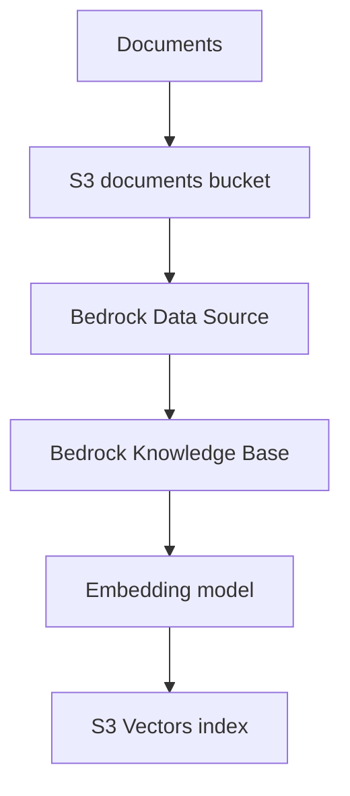

# terraform-aws-bedrock-vector-kb

Terraform module for provisioning Amazon Bedrock Knowledge Bases backed by
Amazon S3 Vectors, with S3 document storage and scoped IAM.

## Architecture



Amazon S3 Vectors is the vector store this module provisions and wires the
Knowledge Base to (either creating a new vector bucket/index, or referencing
an existing one). There is no built-in support for OpenSearch Serverless,
Pinecone, or any other vector store backend.

## Features

Only behavior that is actually implemented:

- Multiple Knowledge Base definitions through a single map input (`kbs`)
- Managed S3 Vectors bucket + index, or bring-your-own existing S3 Vectors
  index ARN
- A dedicated S3 bucket per Knowledge Base for source documents
- Optional chunking configuration (fixed-size, hierarchical, semantic, or no
  chunking), with validation of AWS's documented per-strategy constraints
- Embedding model / vector dimension compatibility validation for
  AWS-documented models, with forward compatibility for unrecognized models
  and an explicit opt-out escape hatch
- Bucket versioning
- S3 Block Public Access enforced on the documents bucket
- TLS-only access enforced on the documents bucket via a bucket policy
- Incomplete multipart upload cleanup (always on)
- Optional noncurrent-version retention (opt-in)
- Optional SSE-KMS encryption, bring your own key (SSE-S3/AES256 by default)
- Optional S3 server access logging to an existing external bucket
- Scoped IAM role and policies for the Bedrock execution role (invoke model,
  read S3 documents, S3 Vectors index access, and optional KMS access)
- A native `terraform test` suite (mock-provider based; no AWS credentials
  required to run it)

## Requirements

This module's own runtime requirement is whatever `versions.tf` declares
(see the generated table below).

Running the native test suite locally is a separate, stricter requirement:
`terraform test` mocking (`mock_provider`) was introduced in Terraform
1.7.0, so contributors need Terraform >= 1.7.0 to run `terraform test`, even
though the module's declared `required_version` floor remains `>= 1.5.0` for
consumers who never run these tests. See [CONTRIBUTING.md](CONTRIBUTING.md).

<!-- BEGIN_TF_DOCS -->
## Requirements

| Name | Version |
| ---- | ------- |
| <a name="requirement_terraform"></a> [terraform](#requirement\_terraform) | >= 1.5.0 |
| <a name="requirement_aws"></a> [aws](#requirement\_aws) | ~> 6.24 |
| <a name="requirement_awscc"></a> [awscc](#requirement\_awscc) | ~> 1.0 |

## Providers

| Name | Version |
| ---- | ------- |
| <a name="provider_aws"></a> [aws](#provider\_aws) | 6.62.0 |
| <a name="provider_awscc"></a> [awscc](#provider\_awscc) | 1.99.0 |

## Resources

| Name | Type |
| ---- | ---- |
| [aws_iam_policy.bedrock_invoke_model](https://registry.terraform.io/providers/hashicorp/aws/latest/docs/resources/iam_policy) | resource |
| [aws_iam_policy.kb_s3_kms](https://registry.terraform.io/providers/hashicorp/aws/latest/docs/resources/iam_policy) | resource |
| [aws_iam_policy.kb_s3_read](https://registry.terraform.io/providers/hashicorp/aws/latest/docs/resources/iam_policy) | resource |
| [aws_iam_policy.s3vectors](https://registry.terraform.io/providers/hashicorp/aws/latest/docs/resources/iam_policy) | resource |
| [aws_iam_role.bedrock_kb](https://registry.terraform.io/providers/hashicorp/aws/latest/docs/resources/iam_role) | resource |
| [aws_iam_role_policy_attachment.invoke_model](https://registry.terraform.io/providers/hashicorp/aws/latest/docs/resources/iam_role_policy_attachment) | resource |
| [aws_iam_role_policy_attachment.s3_kms](https://registry.terraform.io/providers/hashicorp/aws/latest/docs/resources/iam_role_policy_attachment) | resource |
| [aws_iam_role_policy_attachment.s3_read](https://registry.terraform.io/providers/hashicorp/aws/latest/docs/resources/iam_role_policy_attachment) | resource |
| [aws_iam_role_policy_attachment.s3vectors](https://registry.terraform.io/providers/hashicorp/aws/latest/docs/resources/iam_role_policy_attachment) | resource |
| [aws_s3_bucket.kb_docs](https://registry.terraform.io/providers/hashicorp/aws/latest/docs/resources/s3_bucket) | resource |
| [aws_s3_bucket_lifecycle_configuration.kb_docs](https://registry.terraform.io/providers/hashicorp/aws/latest/docs/resources/s3_bucket_lifecycle_configuration) | resource |
| [aws_s3_bucket_logging.kb_docs](https://registry.terraform.io/providers/hashicorp/aws/latest/docs/resources/s3_bucket_logging) | resource |
| [aws_s3_bucket_policy.kb_docs_tls_only](https://registry.terraform.io/providers/hashicorp/aws/latest/docs/resources/s3_bucket_policy) | resource |
| [aws_s3_bucket_public_access_block.kb_docs](https://registry.terraform.io/providers/hashicorp/aws/latest/docs/resources/s3_bucket_public_access_block) | resource |
| [aws_s3_bucket_server_side_encryption_configuration.kb_docs](https://registry.terraform.io/providers/hashicorp/aws/latest/docs/resources/s3_bucket_server_side_encryption_configuration) | resource |
| [aws_s3_bucket_versioning.kb_docs](https://registry.terraform.io/providers/hashicorp/aws/latest/docs/resources/s3_bucket_versioning) | resource |
| [aws_s3vectors_index.this](https://registry.terraform.io/providers/hashicorp/aws/latest/docs/resources/s3vectors_index) | resource |
| [aws_s3vectors_vector_bucket.this](https://registry.terraform.io/providers/hashicorp/aws/latest/docs/resources/s3vectors_vector_bucket) | resource |
| [awscc_bedrock_data_source.s3](https://registry.terraform.io/providers/hashicorp/awscc/latest/docs/resources/bedrock_data_source) | resource |
| [awscc_bedrock_knowledge_base.this](https://registry.terraform.io/providers/hashicorp/awscc/latest/docs/resources/bedrock_knowledge_base) | resource |

## Inputs

| Name | Description | Type | Default | Required |
| ---- | ----------- | ---- | ------- | :------: |
| <a name="input_enable_kbs"></a> [enable\_kbs](#input\_enable\_kbs) | If false, nothing is created. | `bool` | `true` | no |
| <a name="input_kbs"></a> [kbs](#input\_kbs) | Knowledge Bases definition map. | <pre>map(object({<br/>    kb_name             = string<br/>    role_name           = string<br/>    kb_description      = optional(string)<br/>    embedding_model_arn = string<br/><br/>    # Explicit escape hatch for the compatibility check below (see<br/>    # known_embedding_model_dimensions). Only meaningful for a model this<br/>    # module already recognizes: set to true when the maintained map is<br/>    # stale (AWS expanded the model's valid dimensions, or documentation<br/>    # changed before this module was updated) and you have independently<br/>    # confirmed the pair is valid. Unknown/future models never need this -<br/>    # they already pass automatically since the module cannot validate what<br/>    # it doesn't recognize.<br/>    skip_dimension_validation = optional(bool, false)<br/><br/>    # Docs source<br/>    content_bucket = string<br/>    content_prefix = optional(string, "")<br/><br/>    # Chunking strategy for this data source's ingestion. null (default,<br/>    # omitted) sends no vector_ingestion_configuration at all, so AWS<br/>    # applies its own default chunking behavior unchanged from v0.1.0.<br/>    # Exactly the block matching `strategy` may be set (enforced below):<br/>    #   FIXED_SIZE   -> fixed_size<br/>    #   HIERARCHICAL -> hierarchical<br/>    #   SEMANTIC     -> semantic<br/>    #   NONE         -> none of the three<br/>    chunking = optional(object({<br/>      strategy = string<br/><br/>      fixed_size = optional(object({<br/>        max_tokens         = number<br/>        overlap_percentage = number<br/>      }))<br/><br/>      hierarchical = optional(object({<br/>        level_configurations = list(object({<br/>          max_tokens = number<br/>        }))<br/>        overlap_tokens = number<br/>      }))<br/><br/>      semantic = optional(object({<br/>        max_tokens                      = number<br/>        buffer_size                     = number<br/>        breakpoint_percentile_threshold = number<br/>      }))<br/>    }), null)<br/><br/>    # S3 Vectors: either create it, or provide an existing index ARN.<br/>    create_s3vectors          = optional(bool, false)<br/>    s3vectors_bucket_name     = optional(string)<br/>    s3vectors_index_name      = optional(string)<br/>    s3vectors_dimension       = optional(number, 1024)<br/>    s3vectors_distance_metric = optional(string, "cosine")  # cosine|euclidean<br/>    s3vectors_data_type       = optional(string, "float32") # currently float32<br/>    s3vectors_index_arn       = optional(string)            # used when create_s3vectors=false<br/><br/>    # Docs bucket encryption: bring your own KMS key. Default (null) keeps<br/>    # the existing SSE-S3 (AES256) behavior unchanged. Granting this<br/>    # module's IAM policy kms:Decrypt/kms:GenerateDataKey is not, by<br/>    # itself, sufficient - the key's own key policy must also allow the<br/>    # Bedrock execution role (this module does not manage the key or its<br/>    # key policy, since it only accepts an existing key ARN).<br/>    kms_key_arn = optional(string)<br/><br/>    # Docs bucket access logging: bring your own existing logging-destination<br/>    # bucket. Default (null) leaves logging disabled, unchanged from before.<br/>    # This module does not create or configure the destination bucket -<br/>    # it must already be set up to accept S3 access log delivery.<br/>    logging_target_bucket = optional(string)<br/>    logging_target_prefix = optional(string, "")<br/><br/>    # Docs bucket lifecycle: noncurrent object versions are kept forever<br/>    # unless this is set. null (default) = no automatic deletion of old<br/>    # versions, unchanged from before. When set, noncurrent versions older<br/>    # than this many days are expired. This is destructive retention<br/>    # behavior (it permanently deletes old version content, even though it<br/>    # never touches the current/live version) and is therefore<br/>    # consumer-opt-in only, never a default.<br/>    noncurrent_version_expiration_days = optional(number)<br/>  }))</pre> | n/a | yes |
| <a name="input_tags"></a> [tags](#input\_tags) | Extra tags. | `map(string)` | `{}` | no |

## Outputs

| Name | Description |
| ---- | ----------- |
| <a name="output_iam_role_arns"></a> [iam\_role\_arns](#output\_iam\_role\_arns) | IAM Role ARNs used by each KB. |
| <a name="output_knowledge_base_arns"></a> [knowledge\_base\_arns](#output\_knowledge\_base\_arns) | Bedrock Knowledge Base ARNs by key (when available in awscc). |
| <a name="output_knowledge_base_ids"></a> [knowledge\_base\_ids](#output\_knowledge\_base\_ids) | Bedrock Knowledge Base IDs by key. |
| <a name="output_s3vectors_index_arns"></a> [s3vectors\_index\_arns](#output\_s3vectors\_index\_arns) | Resolved S3 Vectors index ARNs by key. |
<!-- END_TF_DOCS -->

## Usage

The simplest usable Knowledge Base, creating its own S3 Vectors store:

```hcl
module "bedrock_kb" {
  source = "github.com/IngMatrix-PGB/terraform-aws-bedrock-vector-kb"

  kbs = {
    default = {
      kb_name             = "my-knowledge-base"
      role_name           = "my-knowledge-base-role"
      embedding_model_arn = "arn:aws:bedrock:us-east-1::foundation-model/amazon.titan-embed-text-v2:0"

      content_bucket = "my-org-kb-documents"

      create_s3vectors      = true
      s3vectors_bucket_name = "my-org-kb-vector-store"
      s3vectors_index_name  = "my-org-kb-vector-index"
    }
  }
}
```

### Using an existing S3 Vectors index

```hcl
kbs = {
  default = {
    kb_name             = "my-knowledge-base"
    role_name           = "my-knowledge-base-role"
    embedding_model_arn = "arn:aws:bedrock:us-east-1::foundation-model/amazon.titan-embed-text-v2:0"
    content_bucket      = "my-org-kb-documents"

    create_s3vectors    = false
    s3vectors_index_arn = "arn:aws:s3vectors:us-east-1:123456789012:bucket/existing-bucket/index/existing-index"
  }
}
```

### SSE-KMS (bring your own key)

```hcl
kbs = {
  default = {
    # ...required fields as above...
    kms_key_arn = "arn:aws:kms:us-east-1:123456789012:key/your-key-id"
  }
}
```

### Access logging (bring your own destination bucket)

```hcl
kbs = {
  default = {
    # ...required fields as above...
    logging_target_bucket = "my-org-access-logs"
    logging_target_prefix = "kb-documents/"
  }
}
```

### Optional noncurrent-version retention

```hcl
kbs = {
  default = {
    # ...required fields as above...
    noncurrent_version_expiration_days = 30
  }
}
```

### Chunking

```hcl
kbs = {
  default = {
    # ...required fields as above...

    chunking = {
      strategy = "FIXED_SIZE"
      fixed_size = {
        max_tokens         = 512
        overlap_percentage = 20
      }
    }
  }
}
```

Omitting `chunking` (the default) sends no chunking configuration at all, so
AWS applies its own default (~300 tokens per chunk, sentence-boundary aware)
- identical to this module's behavior before this field existed. See
"Chunking" below for the full strategy reference and replacement semantics.

### Bypassing embedding model / dimension validation

```hcl
kbs = {
  default = {
    # ...required fields as above...
    embedding_model_arn       = "arn:aws:bedrock:us-east-1::foundation-model/amazon.titan-embed-text-v2:0"
    s3vectors_dimension       = 1536
    skip_dimension_validation = true
  }
}
```

Only needed when this module's known-model map is stale for a model it
already recognizes (see "Embedding Model / Dimension Compatibility" below).
Models this module doesn't recognize never need this flag - they already
pass validation automatically.

## KMS Boundary

`kms_key_arn` is bring-your-own-key: this module never creates or manages a
KMS key. When set, the module grants the Bedrock execution role
`kms:Decrypt` and `kms:GenerateDataKey`, scoped to exactly that key ARN.
That identity-policy grant is necessary but **not sufficient** on its own -
the external key's own key policy must separately allow the Bedrock
execution role. Passing `kms_key_arn` does not, by itself, guarantee
successful KMS access; the key policy is the consumer's responsibility.

## Logging Boundary

`logging_target_bucket` is bring-your-own: this module never creates or
configures the destination logging bucket. The consumer is responsible for
ensuring that destination bucket is set up to accept S3 server access log
delivery (the appropriate bucket policy/permissions for the S3 log delivery
service). If it isn't, log delivery will simply fail silently on the AWS
side - this module cannot detect or prevent that.

## Lifecycle Semantics

**Always enabled**, with no opt-out:
- Abort incomplete multipart uploads after 7 days.

**Opt-in only**, via `noncurrent_version_expiration_days`:
- Noncurrent-version expiration. `null` (the default) means this module
  preserves noncurrent object versions indefinitely - it never deletes them
  on its own. Setting this to a number of days is genuinely destructive
  retention behavior: it permanently deletes old version content once it
  ages past that threshold. It never touches the current/live version of an
  object, but the deletion of noncurrent versions themselves is real and
  irreversible, which is why it is opt-in rather than a default.

## Chunking

`kbs[*].chunking` (optional, default `null`) configures how Bedrock splits
documents into chunks before embedding them. Supported strategies, per the
`awscc_bedrock_data_source` provider schema:

| Strategy | Sub-block | Required fields | Ranges |
|---|---|---|---|
| `FIXED_SIZE` | `fixed_size` | `max_tokens`, `overlap_percentage` | `max_tokens` 1-8192, `overlap_percentage` 1-99 |
| `HIERARCHICAL` | `hierarchical` | `level_configurations` (exactly 2 entries, each `{ max_tokens }`), `overlap_tokens` | `overlap_tokens` >= 1, each level's `max_tokens` >= 1 |
| `SEMANTIC` | `semantic` | `max_tokens`, `buffer_size`, `breakpoint_percentile_threshold` | `max_tokens` 1-8192, `buffer_size` 0-1, `breakpoint_percentile_threshold` 50-99 |
| `NONE` | (none) | - | - |

Exactly the sub-block matching `strategy` may be set; all others must be
omitted. This exclusivity and the ranges above are enforced by this
module's own `variable "kbs"` validation - the AWS API and the
`awscc`/CloudFormation schemas only document these constraints in prose and
accept invalid combinations until `apply` time, where they surface as an
opaque `ValidationException`. Failing at `terraform plan` with a clear
message is strictly better.

For `HIERARCHICAL`, AWS requires exactly 2 `level_configurations` but does
not document an ordering requirement between them; by convention, list the
broader/parent level first and the narrower/child level second, but this
module does not enforce that order.

Omitting `chunking` entirely (the default) sends no
`vector_ingestion_configuration` argument to `awscc_bedrock_data_source`, so
AWS applies its own default chunking behavior (~300 tokens per chunk,
respecting sentence boundaries) - unchanged from this module's behavior
before this field existed.

**Replacement semantics:** per the `AWS::Bedrock::DataSource` CloudFormation
resource schema, `ChunkingConfiguration` is a `createOnlyProperty`. Changing
`chunking` on an existing `kbs` entry - including adding it where it was
previously omitted, or removing it - forces `awscc` to **replace** the
underlying data source resource, not update it in place. Replacing the data
source does **not** automatically re-run ingestion: any documents already
ingested under the old data source are not retained or re-ingested
automatically; a new `StartIngestionJob` against the new data source is
required (see "Bedrock / Ingestion Boundary" below). This module does not
use `lifecycle { prevent_destroy = true }` to mask this behavior - plan
output will show the replacement plainly before you apply it.

## Embedding Model / Dimension Compatibility

Amazon Bedrock rejects an embedding model / vector dimension pair it
doesn't support only at `apply` time (`CreateKnowledgeBase` /
`UpdateKnowledgeBase` `ValidationException`), with no dry-run available and
no dynamic AWS API this module could query to check compatibility ahead of
time - neither `GetFoundationModel`/`ListFoundationModels` nor Terraform's
own `aws_bedrock_foundation_model` data source expose a "supported output
dimensions" field for any model, at all. This module closes part of that gap
by validating each `kbs` entry's `embedding_model_arn` /
`s3vectors_dimension` pair against a small internal map of models AWS
documents as supported for Knowledge Bases' vector embeddings, at
`terraform plan` time, before anything is created.

This map is a point-in-time snapshot of AWS's own [Knowledge Bases
supported-models documentation](https://docs.aws.amazon.com/bedrock/latest/userguide/knowledge-base-supported.html),
current as of this module's PR #11 - **not** an exhaustive or permanent
list. AWS adds embedding models and expands dimension options over time.
Three behaviors follow directly from that:

- A **known** model with a **known-invalid** dimension fails at `plan`
  time with a specific, actionable error (naming the model, the configured
  dimension, and the allowed dimensions) instead of a generic
  `ValidationException` at `apply`.
- An **unknown** model (anything not in this module's map - including any
  model AWS releases after this module was last updated) always **passes**
  validation unconditionally. This module has no way to know whether a
  model it has never heard of is compatible with a given dimension, so it
  does not guess either way; catching that class of mistake is left to AWS
  itself at `apply` time, same as before this validation existed.
- `skip_dimension_validation` (per `kbs` entry, default `false`) is an
  explicit escape hatch for a model this module **does** recognize, for
  when the map is stale - AWS expanded a model's valid dimensions, or
  documentation changed before this module was updated. It does not exist
  to bypass validation for unknown models; those already pass without it.

Models currently in the map:

| Model ID | KB-supported dimensions |
|---|---|
| `amazon.titan-embed-text-v1` | 1536 |
| `amazon.titan-embed-text-v2:0` | 256, 512, 1024 |
| `cohere.embed-english-v3` | 1024 |
| `cohere.embed-multilingual-v3` | 1024 |
| `amazon.titan-embed-image-v1` | 1024 |
| `amazon.nova-2-multimodal-embeddings-v1:0` | 1024 |

Deliberately **not** included, despite appearing adjacent to this list in
AWS's own documentation: Cohere Embed v4 (model ID rendered inconsistently
across AWS's docs, and absent from the Knowledge Bases model/ID table
itself) and a "Cohere Embed v3 (Multimodal)" row that appears in the
Knowledge Bases dimensions table but has no corresponding model card or
model ID anywhere in Bedrock's own model catalog. Both are left out rather
than guessed at.

**A note on `amazon.nova-2-multimodal-embeddings-v1:0` specifically:** its
own Bedrock model card lists "Knowledge base" as an unsupported feature in
its general `bedrock-runtime` capability matrix. That capability matrix
describes using a model as the *generation* model inside a Knowledge
Base's `RetrieveAndGenerate` call, which requires text output - this model
is embedding-only, so it cannot serve that role, unrelated to whether it is
usable as the *embedding* model behind a Knowledge Base's vector index.
The claim of KB compatibility in the table above is scoped specifically to
that narrower, embedding-model question, sourced from Bedrock's dedicated
[Knowledge Bases supported-embedding-models
documentation](https://docs.aws.amazon.com/bedrock/latest/userguide/knowledge-base-supported.html#knowledge-base-supported-embeddings),
which does list it. This module does not claim the model is universally
supported across all Bedrock Knowledge Base execution paths - only that it
is documented as an eligible embedding model. It remains in the map on that
basis; it would be removed only if newer official AWS evidence directly
contradicted its eligibility as a KB embedding model, not merely on the
strength of this one capability-matrix flag, which describes a different
capability.

## Bedrock / Ingestion Boundary

Provisioning the S3 Data Source does **not** mean documents are
automatically or continuously synchronized into the Knowledge Base. Amazon
Bedrock requires an explicit ingestion job (`StartIngestionJob`, via the AWS
Console, CLI, or SDK) to read the S3 documents, generate embeddings, and
write them into the S3 Vectors index. This module does not trigger,
schedule, or manage ingestion jobs - starting and monitoring ingestion is an
operational action outside its scope. This also applies after any chunking
configuration change: changing `chunking` does not itself run
`StartIngestionJob` - see "Chunking" above for why such a change also
replaces the data source resource.

## Security Decisions

**Implemented:**
- S3 Block Public Access
- TLS-only bucket access
- Bucket versioning
- Encryption at rest (SSE-S3 by default, optional SSE-KMS)
- Optional S3 access logging

**Not automatically implemented:**
- Cross-region replication - this module has no disaster-recovery or
  multi-region contract; adding it would mean inventing a destination
  bucket, region, and IAM role with no consumer-driven requirement.
- S3 event notifications - Bedrock ingestion is triggered by
  `StartIngestionJob`, not by S3 events, and this module has no downstream
  consumer (queue, topic, function) for bucket notifications to reach.

These two are architecture/policy decisions for the consumer to make and
implement outside this module if their environment requires them, not gaps
this module leaves unaddressed by omission.

## Contributing

See [CONTRIBUTING.md](CONTRIBUTING.md) for the local development workflow
(formatting, validation, native tests, linting).

## License

[MIT](LICENSE)
