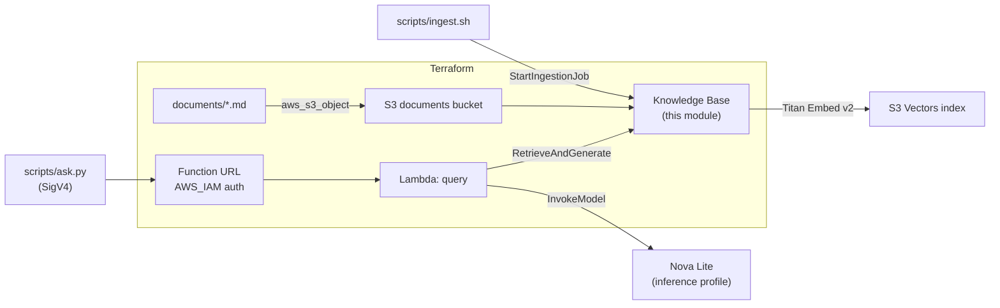

# End-to-end RAG example

A working question-answering service over your own documents, built on
this module: documents in S3 → Bedrock Knowledge Base on S3 Vectors →
a Lambda function behind an IAM-authenticated function URL that calls
`RetrieveAndGenerate` and returns the answer with its sources.



## What it deploys

| Resource | Notes |
|---|---|
| Knowledge Base, data source, S3 Vectors bucket + index, documents bucket | From this module; fixed-size chunking (300 tokens, 20% overlap) |
| 3 sample documents | Fictional runbooks in [`documents/`](documents) - deployment policy, incident response, AWS access |
| Lambda `<name>-query` | Python 3.13, arm64, X-Ray tracing, JSON logs, reserved concurrency |
| Function URL | `AWS_IAM` auth - unsigned requests get `403` |
| CloudWatch log group | 30-day retention, removed on destroy |

## Prerequisites

- An AWS account you can experiment in (not a production account), and
  credentials with permission to create the resources above.
- Terraform >= 1.5, AWS CLI v2, `jq`, Python 3 with `boto3`.
- A region with Bedrock Knowledge Bases and S3 Vectors. The defaults use
  `us-east-1`.
- Model access to **Titan Text Embeddings V2** and **Amazon Nova Lite** in
  the Bedrock console. Amazon models need no use-case form. To use another
  model, set `generation_inference_profile_id`.

## Run it

```bash
cd examples/rag-e2e
terraform init
terraform apply                     # ~2-3 minutes

./scripts/ingest.sh                 # embeds the documents, waits for COMPLETE

python3 scripts/ask.py "When are production deployments frozen?"
python3 scripts/ask.py "Who is Incident Commander by default, and how fast must a SEV1 be paged?"
python3 scripts/ask.py "How do CI pipelines authenticate to AWS?"
```

Follow-up questions keep the conversation context with `--session`:

```bash
python3 scripts/ask.py --session <session_id from the previous answer> "And what about holidays?"
```

Response shape (from `query_url`):

```json
{
  "answer": "...",
  "citations": [{ "source": "s3://<bucket>/docs/deployment-policy.md", "excerpt": "..." }],
  "session_id": "...",
  "guardrail_action": null
}
```

To use your own documents, put `.md` files in `documents/` (or upload any
[supported format](https://docs.aws.amazon.com/bedrock/latest/userguide/knowledge-base-ds.html)
under the `docs/` prefix), then run `terraform apply` and
`./scripts/ingest.sh` again. Bedrock does not watch the bucket: **new or
changed documents are not searchable until an ingestion job runs.**

## Clean up

```bash
terraform destroy
```

`force_destroy = true` is set in this example, so the buckets are removed
with their contents. Nothing keeps running after destroy.

## Cost

S3 Vectors, Knowledge Bases, Lambda and the function URL have no hourly
or minimum charge - you pay per stored vector, per embedded token, per
generated token and per request. Running this demo and asking a handful of
questions should cost cents. Check current prices on the
[Amazon Bedrock](https://aws.amazon.com/bedrock/pricing/) and
[S3 Vectors](https://aws.amazon.com/s3/pricing/) pricing pages before
loading a large corpus.

`lambda_reserved_concurrency` (default 5) caps how many questions run at
once, which bounds spend if the URL gets called in a loop.

## Security decisions

| Decision | Why |
|---|---|
| Function URL with `AWS_IAM`, never `NONE` | Every call spends money on Bedrock; only principals holding `query_caller_policy_document` can call it |
| Caller policy limited to the function URL path | `lambda:InvokeFunctionUrl` requires `lambda:FunctionUrlAuthType = AWS_IAM`; `lambda:InvokeFunction` requires `lambda:InvokedViaFunctionUrl = true` (both are needed for function URLs created since October 2025) |
| `bedrock:Retrieve` scoped to this Knowledge Base | The function cannot read any other Knowledge Base |
| `bedrock:InvokeModel` scoped to one inference profile, plus its foundation models only through that profile (`bedrock:InferenceProfileArn` condition) | Cross-region inference checks both ARNs; the model ARNs come from the `aws_bedrock_inference_profile` data source instead of being hard-coded |
| `bedrock:RetrieveAndGenerate` on `*` | The action has no resource type in the IAM Service Authorization Reference; what it can reach is bounded by the two grants above |
| Lambda trust policy with `aws:SourceAccount` | Confused-deputy protection |
| The question text is never logged | Logs carry request ID, question length, citation count and latency only |
| Input validation before calling Bedrock | Rejects non-POST, invalid JSON, empty or oversized questions with `400`, without spending a model call |
| Optional Guardrail (`guardrail_id`) | Adds `bedrock:ApplyGuardrail` on that guardrail only when set |

Checkov findings skipped on purpose, with the reason inline in
[`lambda.tf`](lambda.tf): no VPC (the function only calls Bedrock's
public endpoint), no DLQ (synchronous invocation), no code signing, no
customer-managed KMS key for environment variables (no secrets in them) or
logs, and 30-day log retention. Revisit each of these before using the
pattern with real data.

## Tests

```bash
cd lambda && python3 -m unittest discover -s tests -v
```

The handler tests use a fake Bedrock client: request building, citation
deduplication, guardrail wiring, input validation, error mapping
(throttling → `429`, other Bedrock errors → `502`) and the no-question-in-logs
rule. CI runs them on every pull request, together with
`terraform validate` for this example.

## Troubleshooting

| Symptom | Likely cause |
|---|---|
| `ingest.sh` fails with `AccessDeniedException` on the embedding model | Model access for Titan Text Embeddings V2 not enabled in this region |
| `ask.py` returns `403` | Your credentials do not hold `query_caller_policy_document`, or the request was not signed for this region |
| `502` with `AccessDeniedException` | Model access for the generation model not enabled, or the inference profile routes to a region where it is not enabled |
| Answer says it cannot find the information | Ingestion has not run since the documents changed - run `./scripts/ingest.sh` |
| `429` | Bedrock throttling or reserved concurrency reached; retry |

<!-- BEGIN_TF_DOCS -->
## Requirements

| Name | Version |
| ---- | ------- |
| <a name="requirement_terraform"></a> [terraform](#requirement\_terraform) | >= 1.5.0 |
| <a name="requirement_archive"></a> [archive](#requirement\_archive) | ~> 2.7 |
| <a name="requirement_aws"></a> [aws](#requirement\_aws) | ~> 6.24 |
| <a name="requirement_awscc"></a> [awscc](#requirement\_awscc) | ~> 1.0 |

## Providers

| Name | Version |
| ---- | ------- |
| <a name="provider_archive"></a> [archive](#provider\_archive) | 2.8.1 |
| <a name="provider_aws"></a> [aws](#provider\_aws) | 6.70.0 |

## Resources

| Name | Type |
| ---- | ---- |
| [aws_cloudwatch_log_group.query](https://registry.terraform.io/providers/hashicorp/aws/latest/docs/resources/cloudwatch_log_group) | resource |
| [aws_iam_role.query](https://registry.terraform.io/providers/hashicorp/aws/latest/docs/resources/iam_role) | resource |
| [aws_iam_role_policy.query](https://registry.terraform.io/providers/hashicorp/aws/latest/docs/resources/iam_role_policy) | resource |
| [aws_lambda_function.query](https://registry.terraform.io/providers/hashicorp/aws/latest/docs/resources/lambda_function) | resource |
| [aws_lambda_function_url.query](https://registry.terraform.io/providers/hashicorp/aws/latest/docs/resources/lambda_function_url) | resource |
| [aws_s3_object.documents](https://registry.terraform.io/providers/hashicorp/aws/latest/docs/resources/s3_object) | resource |

## Inputs

| Name | Description | Type | Default | Required |
| ---- | ----------- | ---- | ------- | :------: |
| <a name="input_embedding_dimension"></a> [embedding\_dimension](#input\_embedding\_dimension) | Vector dimension; must be one the embedding model supports. | `number` | `1024` | no |
| <a name="input_embedding_model_id"></a> [embedding\_model\_id](#input\_embedding\_model\_id) | Bedrock embedding model for the Knowledge Base. | `string` | `"amazon.titan-embed-text-v2:0"` | no |
| <a name="input_generation_inference_profile_id"></a> [generation\_inference\_profile\_id](#input\_generation\_inference\_profile\_id) | Cross-region inference profile used to generate answers. Amazon Nova Lite is cheap and needs no use-case form. | `string` | `"us.amazon.nova-lite-v1:0"` | no |
| <a name="input_guardrail_id"></a> [guardrail\_id](#input\_guardrail\_id) | Optional Bedrock Guardrail ID applied to generated answers. null = no guardrail. | `string` | `null` | no |
| <a name="input_guardrail_version"></a> [guardrail\_version](#input\_guardrail\_version) | Guardrail version used when guardrail\_id is set. | `string` | `"DRAFT"` | no |
| <a name="input_lambda_reserved_concurrency"></a> [lambda\_reserved\_concurrency](#input\_lambda\_reserved\_concurrency) | Hard cap on concurrent query executions - bounds Bedrock spend if the URL is called in a loop. | `number` | `5` | no |
| <a name="input_log_retention_days"></a> [log\_retention\_days](#input\_log\_retention\_days) | CloudWatch Logs retention for the query function. | `number` | `30` | no |
| <a name="input_name"></a> [name](#input\_name) | Name prefix for every resource in this example. | `string` | `"rag-demo"` | no |
| <a name="input_number_of_results"></a> [number\_of\_results](#input\_number\_of\_results) | Chunks retrieved from the vector index per question. | `number` | `5` | no |
| <a name="input_region"></a> [region](#input\_region) | AWS region. Must support Bedrock Knowledge Bases, S3 Vectors and the chosen models. | `string` | `"us-east-1"` | no |

## Outputs

| Name | Description |
| ---- | ----------- |
| <a name="output_content_bucket"></a> [content\_bucket](#output\_content\_bucket) | Bucket holding the source documents. |
| <a name="output_data_source_id"></a> [data\_source\_id](#output\_data\_source\_id) | Data source ID (used by scripts/ingest.sh). |
| <a name="output_ingestion_policy_document"></a> [ingestion\_policy\_document](#output\_ingestion\_policy\_document) | Least-privilege policy JSON for whoever runs scripts/ingest.sh. |
| <a name="output_knowledge_base_id"></a> [knowledge\_base\_id](#output\_knowledge\_base\_id) | Knowledge Base ID (used by scripts/ingest.sh). |
| <a name="output_query_caller_policy_document"></a> [query\_caller\_policy\_document](#output\_query\_caller\_policy\_document) | IAM policy JSON to attach to whoever may call query\_url. |
| <a name="output_query_log_group"></a> [query\_log\_group](#output\_query\_log\_group) | CloudWatch log group of the query function. |
| <a name="output_query_url"></a> [query\_url](#output\_query\_url) | Function URL (AWS\_IAM auth). Call it with scripts/ask.py. |
<!-- END_TF_DOCS -->
